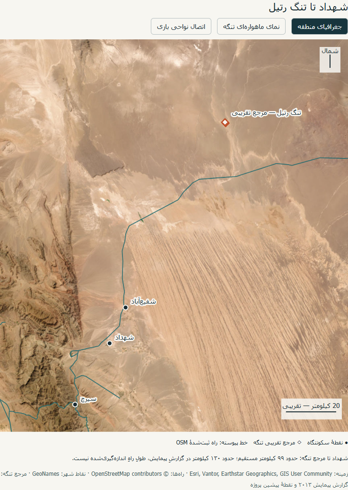

# ردِ هور — سناریو و طراحی گیم‌پلی

مرجع جاری (Canon جدید): **نسخهٔ ۱۳ (`v13`)** — پیوندِ ستونِ دراماتیکِ **«اسم و گناه»** با ساختارِ عملیاتی، تقویمِ واحد و فینالِ قابل‌بازیِ باندِ نمکزار؛ استوار بر دفترِ مرجعِ واحد ([`00_CANON_LEDGER_FA.md`](gameStory/redesign/v13/00_CANON_LEDGER_FA.md)) و راستی‌آزماییِ خودکار ([`tools/check_v13_continuity.py`](tools/check_v13_continuity.py)).

## شروع مطالعه (نسخهٔ ۱۳ — Canon جدید)

- [نقشهٔ فهرستِ اسنادِ نسخهٔ ۱۳](gameStory/redesign/v13/README.md)
- [۰۰ — دفترِ مرجعِ واحدِ کانن (Single Source of Truth)](gameStory/redesign/v13/00_CANON_LEDGER_FA.md)
- [۰۱ — بایبلِ داستان، قوانینِ H-0 و پایان‌بندی](gameStory/redesign/v13/01_STORY_BIBLE_FA.md)
- [۰۲ — بایبلِ شخصیت‌ها (۱۷ چهره با قالبِ ۷ خطی)](gameStory/redesign/v13/02_CHARACTERS_FA.md)
- [۰۳ — تقویمِ یکپارچهٔ ۶ روزه و پنجره‌های اعتبار](gameStory/redesign/v13/03_TIMELINE_FA.md)
- [۰۴ — فیلم‌نامهٔ کامل (پیش‌درآمد + ۱۵ فصل + اپیلوگ — ۴۵ نما)](gameStory/redesign/v13/04_SCREENPLAY_FA.md)
- [۰۵ — طراحیِ گیم‌پلی، افعال، مأموریت‌های M00–M40 و منحنیِ بازشدن](gameStory/redesign/v13/05_GAMEPLAY_FA.md)
- [۰۶ — جهان، مکان‌ها، وسایلِ نقلیه و زرادخانه](gameStory/redesign/v13/06_WORLD_AND_PLACES_FA.md)
- [۰۷ — منشورِ کارگردانی، استانداردِ دیالوگ و برشِ عمودیِ دمو](gameStory/redesign/v13/07_DIRECTION_FA.md)
- [کارنامهٔ تغییرات و رفعِ یافته‌های بازبینی (`CHANGELOG`)](gameStory/redesign/v13/CHANGELOG.md)
- [رمانِ کاملِ نسخهٔ ۱۳ (۲۱ فصل)](novel/v13/RAD_E_HOOR_NOVEL_V13_FA.md)
- [نقشهٔ جغرافیایی و چیدمان پیشنهادی](gameStory/redesign/v7-20261121/maps/README_FA.md)
- [کتابخانهٔ تصاویر کانسپت](gameStory/images/README.md)

## نقشه

تصویرِ منطقه‌ای بر دادهٔ جغرافیایی تکیه دارد؛ نشانِ تنگه تقریبی و چیدمانِ داخلی و تأسیساتِ داستانی پیشنهادی‌اند. منابع، انتساب‌ها و حدودِ دقت در [راهنمای نقشه](gameStory/redesign/v7-20261121/maps/README_FA.md) آمده‌اند.

## آرشیوِ نسخه‌های پیشین (قابلِ انتخاب در وبسایت: `v13` / `v12` / `v11`)

- **نسخهٔ ۱۲ (بازار بین‌المللی — اکشنِ خالص):** [راهنمای نسخهٔ ۱۲](gameStory/redesign/v12-international/README.md) · [فیلم‌نامهٔ نسخهٔ ۱۲](gameStory/redesign/v12-international/SCREENPLAY_V12_FA.md) · [رمانِ نسخهٔ ۱۲](novel/v12/RAD_E_HOOR_NOVEL_V12_FA.md)
- **نسخهٔ ۱۱ (روایتِ درامِ بومی — AAA):** [راهنمای نسخهٔ ۱۱](gameStory/redesign/v11-aaa/README.md) · [فیلم‌نامهٔ نسخهٔ ۱۱](gameStory/redesign/v11-aaa/SCREENPLAY_V11_FA.md) · [رمانِ نسخهٔ ۱۱](novel/RAD_E_HOOR_NOVEL_FA.md)
- پوشه‌های `gameStory/redesign/v10-bible/` و `gameStory/redesign/v7-20261121/` برای ارجاع به نقشه‌ها، شواهد جغرافیایی و تاریخچهٔ طراحی نگهداری می‌شوند.
