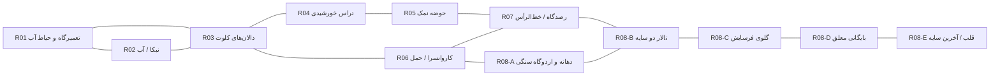

# رد هور — جهان و مأموریت‌های بازطراحی ۷

تاریخ: ۲۱ نوامبر ۲۰۲۶. وضعیت: **طرح نویسندگی و طراحی؛ بدون پیاده‌سازی، بدون ادعای زمان بازیِ اندازه‌گیری‌شده.** این سند توپولوژیِ بازی، مأموریت‌ها و بودجهٔ مدت را مالک است؛ **جغرافیای منطقه‌ایِ واقعی از مساحت و اتصالِ بخش‌های طراحی‌شده جدا ثبت می‌شود.** مرجع مرکزی داستان، دفترِ منبعِ نقشهٔ جغرافیایی و قواعد علم در همین بسته بر آن تقدم دارند. ابعادِ سکتورهای بازی، برداشتِ زمینی یا مرزِ تأییدشدهٔ تنگ رتیل نیستند.

جزئیاتِ مسیریابیِ چهارمرحله‌ایِ شب، سه پرداختِ زیباییِ آسمان و شش کشفِ اختیاریِ علمی در [آسمانِ شب و کشف‌های پنهان](NIGHT_SKY_NAVIGATION_AND_EASTER_EGGS_FA.md) آمده‌اند؛ همگی در بودجهٔ همین مأموریت‌ها/Q07/X06 قرار دارند.

برای نقشهٔ واقعی، [دفترِ شواهدِ جغرافیا](GEOGRAPHY_EVIDENCE_FA.md) و [نقشه‌ها و منابع](maps/README_FA.md) مرجع‌اند؛ هیچ GPXِ تأییدشده یا برداشتِ کاملِ هندسهٔ تنگه در این بسته ادعا نمی‌شود. گردشِ ماده، عیار، معامله، شکارِ خوراکی و تحویلِ فیزیکیِ آب در [منابع، معاش و تأمینِ آب](RESOURCES_TRADE_SURVIVAL_AND_WATER_SUPPLY_FA.md) تفصیل دارند. W01/W02 مختصاتِ قطعیِ واقعی نگرفته‌اند و محلشان پس از بررسیِ زیستگاه تعیین می‌شود.

## ۱. قرارداد جهان: هر راه باید چیزی را عوض کند

تنگه مقصدی نیست که پس از اتمام محتوای دشت بالاخره به آن برسیم. نخستین ورود جدی در فصل ۳ رخ می‌دهد؛ در فصل‌های ۵ و ۷ با دانش و شرایط متفاوت برمی‌گردیم؛ فصل‌های ۹ و ۱۰ یک حرکت پیوسته در ژرفای آن‌اند. افشای اصلی، رویارویی نهایی، تصمیم دربارهٔ دستگاه و آخرین صحنه **داخل تنگه** اتفاق می‌افتند. شهر، دشت و تأسیسات پیرامونی پاسخ و ابزار می‌دهند، اما جای تنگه را در روایت نمی‌گیرند.

هویت محیط از همکاری چهار چیز می‌آید: رسوبات فرسوده و شکننده؛ نور و سایهٔ متحرک؛ مسیرهای باد و شن؛ زیرساختی انسانی که برای کار در این طبیعت ساخته و سپس برای کنترل دیگران استفاده شده است. یک رنگ کهربایی همهٔ این موارد را توضیح نمی‌دهد. آفتاب واقعی هم انرژی می‌دهد و هم سطح را داغ می‌کند؛ میدان خیالی R17 قانون جدا و علامت جدا دارد.

جهان **نیمه‌باز با بخش‌های قابل‌بازیِ پیوستهٔ محلی و اتصالِ منطقه‌ایِ آشکار** است: منطقه‌ها قابل‌شناسایی‌اند، اما فهرستِ پادگان برای پاکسازی نیستند. شهداد، شفیع‌آباد و سیرچ در یک جعبهٔ کوچکِ ساختگی کنار تنگه چیده نمی‌شوند. ادعای قبلیِ قرارگرفتنِ همهٔ جهان در ۱۴×۱۰ کیلومتر **بازنشسته است**؛ تا دریافتِ مسیرِ معتبر/مدلِ ارتفاعی، حتی محیطِ مرکزیِ تنگه نیز چنین مرزِ اندازه‌گیری‌شده‌ای ندارد. سفرِ منطقه‌ای روی نقشهٔ واقعی جای خود را حفظ می‌کند و با برشِ روشنِ مسیر/گذشتِ زمان به سکتورِ بعد وصل می‌شود، نه صد کیلومتر پیاده‌رویِ اجباری یا انتقالِ نامرئیِ شهر.

### ۱.۱ دو لایهٔ لازمِ نقشه

**لایهٔ جغرافیای منطقه‌ای:** آبادی‌ها، جهت‌ها، راه‌های عمومی و جایِ کاندیدِ تنگه از دادهٔ نقشه و گزارشِ منبع خوانده می‌شوند. مختصاتِ آبادی نقطهٔ نام‌گذاری/مرجع است، نه مرزِ بافتِ شهری. راهی که در نقشهٔ عمومی دیده می‌شود، بدون بررسیِ بیشتر به مسیرِ مجاز/ایمنِ سفر تعبیر نمی‌شود.

| مرجعِ واقعی / کاندید | عرض شمالی، طول شرقی | قراردادِ استفاده |
| --- | --- | --- |
| شهداد | `30.41739°N, 57.70670°E` | R01 مرکزِ خدماتی در جایگاهِ منطقه‌ایِ شهداد؛ حیاط و آدم‌های بازی بازآفرینی‌اند |
| شفیع‌آباد | `30.54554°N, 57.77325°E` | مرجعِ منطقه‌ایِ شمال/شمال‌شرقِ شهداد؛ محلِ دقیقِ نبکا/آبشخورِ بازی پس از بررسیِ زیستگاه انتخاب می‌شود |
| سیرچ | `30.19793°N, 57.56276°E` | مرجعِ جداگانهٔ جنوب‌غربِ شهداد؛ در قابِ مرکزیِ تنگه یا همسایگیِ جعلیِ آن قرار نمی‌گیرد |
| کاندیدِ تنگ رتیل، بر پایهٔ DMSِ گزارشِ پیمایشِ ۱۳۹۲ | `31.2027778°N, 58.1902778°E` | تبدیلِ نوشتارِ `31°12′10″N, 58°11′25″E`؛ اعشارِ بیشتر به معنیِ دقتِ برداشتِ بیشتر نیست |
| نقطهٔ پیشینِ ارائه‌شدهٔ کاربر | `31.2061355°N, 58.18755°E` | مرجعِ پیشنهادیِ قبلی؛ حدود ۴۵۵ متر با نقطهٔ گزارش فاصله دارد؛ یکی بی‌مدرک «دهانهٔ قطعی» اعلام نمی‌شود |

فاصلهٔ مستقیمِ شهداد تا کاندیدِ گزارش حدود **۹۸٫۸ کیلومتر** است؛ عددِ حدود **۱۳۰ کیلومتر مسیر** از گزارشِ مشاهده‌گر می‌آید و با مسیرِ GPXِ بررسی‌شده در این بسته تأیید نشده است. این دو عدد نوعِ اندازه‌گیریِ یکسان ندارند. مسیرِ دقیق، محلِ ورود، طولِ کفِ تنگه، ارتفاع/عرضِ دیواره‌ها و انشعاب‌ها هنوز نقشه‌برداریِ لازم دارند. [گزارشِ پیمایشِ تنگ رتیل، ۱۳۹۲](https://www.irandeserts.com/article/تنگ-رتیل،-لوت-شمالی/)

**لایهٔ طراحیِ بخش‌های قابل‌بازی:** حدود ۲۵ کیلومترمربعِ زیر، **جمعِ هدفِ مساحتِ سکتورهای جدا از هم** است؛ نه چندضلعیِ واحدِ واقعی پیرامونِ شهداد، نه مساحتِ برداشت‌شدهٔ تنگ رتیل و نه ادعای محصولِ ساخته‌شده. اتصالِ بازی می‌تواند یک گذرِ محلی، جادهٔ منطقه‌ای یا برشِ سفرِ دارای زمان باشد. تأسیسات خورشیدی، حیاطِ حمل، رصدگاه و محلِ خدماتِ حوضه در این مرحله **ساختگی و فاقد مختصاتِ نهایی** هستند؛ برایشان نقطهٔ تصادفی روی زمینِ واقعی نمی‌گذاریم.

### هشت منطقه

| کد | منطقه و مساحت قابل‌استفادهٔ هدف | کارکرد و سیلوئت | چیزی که بازیکن آنجا انجام می‌دهد | دگرگونی معنادار |
| --- | --- | --- | --- | --- |
| R01 | سکتورِ خدماتی در مرجعِ واقعیِ شهداد؛ ۱٫۲ km² هدفِ طراحی | حیاط‌های کم‌ارتفاع، تعمیرگاه، سایبان و اتاق تقسیم آب | تعمیر، تمرین کوتاه سلاح، گرفتن کار و مذاکره دربارهٔ بار | بر اثر قطع تدارکات، تعمیرگاه به مرکز امداد و اختلاف تبدیل می‌شود؛ شهر غیب نمی‌شود |
| R02 | سکتورهای حاشیهٔ نبکا/خدماتِ آب در پیرامونِ شهداد–شفیع‌آباد؛ ۳٫۴ km² هدف؛ نقطه‌ها پس از بررسیِ اکولوژی | تپه‌های گیاهی پراکنده، مخازن انسانی و مسیر باد | دنبال‌کردن رد، مراقبت از آب، عبور بی‌صدا و تشخیص اثر دست‌کاری | حرکت شن و شکست یک خط لوله مسیرها را عوض می‌کنند؛ گیاهان تزئین قابل‌تخریب برای غارت نیستند |
| R03 | سکتورهای انتخاب‌شدهٔ گذرِ منطقه‌ایِ کلوت؛ ۵٫۱ km² هدف، با راه/فاصلهٔ واقعیِ جداگانه | دیواره‌های نامنظم و راه‌های موازیِ زمینی | رانندگی فنی، تعقیب، کمین، دورزدن و نجات خودرو | جبههٔ باد بعضی ردها را پاک می‌کند؛ ایستگاه‌های روشن‌شده و سایبان‌های ساخته‌شده نشانه‌های پایدار می‌شوند |
| R04 | ایستگاهِ خورشیدیِ ساختگی؛ ۳٫۱ km² هدف؛ مختصات هنوز تعیین نشده | ردیف پنل، برج خدمات، آینهٔ آزمایشی محدود و کابل | تغییر توزیع برق، نفوذ به اتاق کنترل، مقابله با دیده‌بانی و هدایت خودرو | خاموش‌کردن بخشی از آرایه هم توان نظارت را کم می‌کند و هم برق پمپ/درمانگاه را می‌گیرد؛ راه‌حل به بار اضطراری نیاز دارد |
| R05 | حاشیهٔ حوضه/محوطهٔ خدماتِ ساختگی؛ ۴٫۳ km² هدف؛ محل و پیوندِ زیستگاهی هنوز بررسی می‌شود | سطح سفید با پوسته‌های متفاوت، آبراههٔ خشک و برجک کوتاه | تشخیص زمین، جست‌وجوی خودروی گمشده، خواندن ساعت و حرکت شبانه | سطح پس از رویداد داستانی ترک می‌خورد؛ مسیر امن قبلی کوتاه‌ترین مسیر بعدی نیست |
| R06 | کاروانسرای خدماتی و حیاطِ حملِ ساختگی؛ ۱٫۷ km² هدف؛ بنای تاریخیِ واقعی را محلِ جرم اعلام نمی‌کند | حیاط مرکزی با دو ارتفاع، انبار، جرثقیل و راه خدمات | گفت‌وگو زیر فشار، سرقت داده، مبادله، آزادکردن افراد و قطع تعقیب | مردم و کسبه با امنیت و آب ارتباط دارند؛ نگهبانی از انبار با کنترل همهٔ زندگی مردم یکی نیست |
| R07 | سکتورِ خط‌الرأس/رصدگاهِ ساختگی؛ ۲٫۲ km² هدف؛ اتصال به تنگه نیازمند بررسیِ ارتفاع و مسیر است | افق باز، پل خدمات، بادگیر و ایستگاه ساعت | مثلث‌بندی، صعود، اتصال مخابرات، کمین معکوس و بازسازی مشاهده‌ها | با بازشدن مسیر طنابی، رفت‌وبرگشت پیاده کوتاه می‌شود؛ طوفان مخابرات را موقتاً محدود می‌کند |
| R08 | تنگهٔ رواییِ هور، الهام از ناحیهٔ کاندیدِ تنگ رتیل؛ ۴٫۰ km² هدفِ سکتور، نه مساحتِ واقعیِ تنگه | پنج پهنهٔ پیشنهادیِ متصل، با مسیر عمودی و زیرگذر؛ هندسهٔ واقعی هنوز برداشت نشده | پژوهش عملی زیر آتش، نجات، سایه‌خوانی، مبارزه و تصمیم نهایی | دانش و وضعیت شبکه، کاربرد مسیر را عوض می‌کنند؛ هندسه هر بار تصادفی بازسازی نمی‌شود |

مساحتِ هدفِ این سکتورهای **جدا از هم** جمعاً ۲۵٫۰ km² است. بزرگ‌کردن این رقم بدون افزودن تصمیم، تضاد و کنش ممنوع است. این جمع، فاصلهٔ شهداد تا تنگه را کم نمی‌کند. نقشهٔ منطقه‌ای محلِ واقعی و مسیرِ سفر را نشان می‌دهد؛ نقشهٔ داخلیِ سکتور، راهِ پیاده/خودرو و چیدمانِ داستانی را. مرحلهٔ ساخت می‌تواند ابعادِ هدف را کم کند، اما شهرها را بی‌اطلاعِ بازیکن به کنارِ تنگه منتقل نمی‌کند.

برای هر انتقال سه نوع ثبت لازم است: **گذرِ محلیِ قابل‌پیمایش** با فاصله و زمانِ همان سکتور؛ **سفرِ منطقه‌ای** با تکه‌های رانندگیِ طراحی‌شده و برشِ روشنِ مبدأ/مقصد/گذشتِ زمان؛ و **اتصالِ پیشنهادیِ هنوزنقشه‌برداری‌نشده** که تا تأییدِ مسیر/ارتفاع قطعی نمی‌شود. سوخت، بار، آدمِ همراه و وسیله در برشِ منطقه‌ای موقعیتِ تازهٔ توضیح‌پذیر می‌گیرند. بیست‌وپنج دقیقهٔ کنشِ رانندگیِ یک مأموریت به معنیِ طیِ جادهٔ حدودصدکیلومتری در بیست‌وپنج دقیقهٔ داستان نیست.

### اتصال‌ها و قفل‌های قابل‌فهم — نمودارِ دسترسیِ بازی، نه نقشهٔ جغرافیایی

خط‌های نمودارِ زیر **رابطهٔ دسترسی/مأموریت** هستند؛ جهتِ شمال، فاصلهٔ مستقیم، همسایگیِ واقعی، جادهٔ پیموده‌شده یا مقیاس را نمایش نمی‌دهند. بعضی خط‌ها گذرِ محلی‌اند و بعضی سفرِ منطقه‌ای با برشِ زمان. جایِ دقیقِ اتصال‌ها پس از دادهٔ ارتفاعی/مسیرِ معتبر تنظیم می‌شود؛ برای دیدنِ نقشهٔ واقعی باید به سند/خروجیِ جغرافیاییِ جداگانهٔ همین بسته رجوع کرد.

اتصالِ پیشنهادیِ محلیِ R07→R08-B ابتدا دیده می‌شود ولی طناب و تأیید تکیه‌گاه می‌خواهد؛ در M23 (فصل ۶) باز می‌شود. این پلِ روایی، مسیرِ موجودِ تأییدشده در تنگ رتیل نیست و تا شناختِ ارتفاع/شکاف امکانِ اصلاح دارد. راه R04→R05 بستهٔ روایی نامرئی ندارد: برق حصار و نگهبانی مشخص‌اند؛ راه طولانیِ مجاز هم وجود دارد. درهٔ نهایی پس از آسیب فصل ۹، با علائم روشن و امکان بازگشت تا پایگاه آخر به بخش پایان تبدیل می‌شود. پیش از تعهدِ نهایی، رابط محدودیتِ بازگشت آزاد را می‌گوید و اجازهٔ ذخیره/آماده‌شدن می‌دهد؛ وعدهٔ حذفِ مأموریت‌های قبلی نیست.

## ۲. پنج پهنهٔ تنگه و تفاوت سه بازگشت

| پهنه | هندسه و نشانهٔ پایدار | ورود اول | بازگشتِ متحول | کاربرد در پایان |
| --- | --- | --- | --- | --- |
| A — دهانه / اردوگاه سنگی | قوس رسوبی، سکوی خودرو، دیوار خط‌کش و دو خروج | آموزش تفاوت بازتاب و منبع، ایجاد پایگاه کوچک | مردم نجات‌یافته و ابزارِ تحویل‌شده آن را عوض می‌کنند؛ مسیر حمل باز می‌شود | پشتیبانی آخر از همین‌جا انجام می‌شود؛ نقطهٔ شروع نبرد نهایی نیست |
| B — تالار دو سایه | ستون شکسته و دو شکاف آسمان؛ سایهٔ طبیعی و نور دستگاه از دو جهت | بازیکن تفاوت دو منبع را اندازه می‌گیرد | خاموش‌شدن آرایه، سایهٔ مصنوعی را حذف می‌کند و مسیر حرارتیِ دیگری باز می‌شود | مسیر قطع نور به قلب از این‌جا دیده و انتخاب شده است؛ رتیل: کف‌های r=1 و لبهٔ تالار (M11، M28) |
| C — گلوی فرسایش | قوس ناپایدار، مسیر کف، طاقچه و زیرگذرِ خشک | خودرو از این‌جا جلوتر نمی‌رود؛ حرکت عمودی و صوت اولویت دارند | کار گذاشتن مهار و مشاهدهٔ تنش، مسیر بار و همراه را باز می‌کند | ریزشِ ازقبل‌هشدارشده راه امن را تغییر می‌دهد؛ انفجار تصادفیِ بدون نشانه نداریم؛ رتیل: شکاف‌ها و زیرگذر (M17–M20) |
| D — بایگانی معلق | سکوی انسانی در دیواره، پل خدماتی و اتاق دو ساعت | دادهٔ ناقص، حضور انسان و روش ثبت عادی دیده می‌شود | بازیکن درمی‌یابد کدام داده جابه‌جا و کدام ساعت جدا شده بود | نجات کیان و انتقال شاهد به محل امن، هم‌زمان با جداسازی انرژی انجام می‌شود؛ رتیل: لبهٔ سکو و پل (M33–M35) |
| E — قلب / آخرین سایه | شکاف عمودی، سکوی R17، کانال کابل و پناه سخت | در فاصله دیده می‌شود؛ بسته‌بودن آن علت فنی و انسانی دارد | نقشهٔ قابل‌فهمِ ورودی‌ها در فصل ۸ کامل می‌شود | معما، نبرد با کامران و خاموش‌سازی در همین فضای خوانا حل می‌شوند؛ آخرین قاب نیز این‌جاست؛ رتیل: فقط در مسیر کابل/طاقچهٔ M38، نه روی سکوی دوئل |

**رتیل‌های هور** فقط در پهنه‌های B، C، D و E‌اند؛ هرگز در دهانهٔ A، R01–R07 یا آبشخورها (تعریف در §۴). در M09 نخستین نشانه از لبهٔ B شنیده می‌شود، نه از A.

بازگشت اول با پرسش «چه اتفاقی افتاده؟»، دوم با پرسش «چه کسی شرایط را عوض می‌کند؟» و سوم با پرسش «چگونه آدم‌ها را بدون تکرار همان تصمیم نجات بدهیم؟» انجام می‌شود. در هر بازگشت دست‌کم دو مورد از وضعیت انسانی، منبع نور، مسیر بار، خطر و دانش کارکردی تغییر می‌کند. بازگشت صرفاً برای پیدا کردن سه کلید رنگی نیست.

حجم‌های دارای نرخ ساعت متفاوت **محفظه/آستانهٔ انتقالِ ثابت** دارند. تمام درگیری‌های M19 و M33 روی کفِ خدماتی یا گذرِ خنثی انجام می‌شوند؛ بازیکن و دشمن از دو نرخ مختلف به یکدیگر شلیک نمی‌کنند. بدن برای انتقال کامل وارد حجمِ میانیِ خنثی می‌شود؛ در دو طرف هم‌زمان باز نمی‌ماند و هیچ دست، پا یا طنابِ در حال کنش به‌عنوان راهِ دورزدنِ مرز نمایش داده نمی‌شود. دوئل M39 نیز در فضای با نرخ عادی است؛ محفظهٔ نجات مجاور مدار مستقل دارد. قاعدهٔ علمی‌تخیلی نباید در مرحلهٔ اکشن به قدرتِ حملهٔ پنهان تبدیل شود.

## ۳. آفتاب، شب و رفت‌وآمد

سایه راهی برای کاهش دیده‌شدنِ معمول و بار حرارتی است؛ پوشش فیزیکی در برابر گلوله همچنان جنس و ضخامت دارد. پایگاه دیده‌بانیِ دارای حسگر حرارتی با رفتن زیر سایه نابینا نمی‌شود. مسیر سایه باید از روی شکل محیط پیش‌بینی شود و برای کم‌بینایی، خوانش کنتراست و نشانگر حرارتِ اختیاری دارد. پازلِ تشخیص رنگِ دو نور، راه‌حل اصلی نیست.

| وضعیت | مزیت بازیکن | ریسک و ضدراه‌حل | اثر روی مأموریت |
| --- | --- | --- | --- |
| صبح | خطوط بلند سایه، سطح سردتر، برق خورشیدی رو به افزایش | نگهبانی بیدار و صدای روشن‌شدن کارگاه | نفوذ از کنار پنل‌ها، انتخاب محل سایبان |
| ظهر | بیشترین ظرفیت آنی شبکه در شرایط مناسب، دید دور | بار گرما، خیرگی، سایهٔ کوتاه؛ پنل داغ الزاماً پربازده‌تر نیست | مأموریتِ جابه‌جایی بار به مرحله‌های کوتاه و پناه‌های واقعی تقسیم می‌شود |
| عصر | سایه‌های کشیده در جهت دیگر، تدارک کاروان | نور کم روی پرتگاه، تغییر وضعیت مسیر حرارتی | بازیکن مسیری را که صبح پشت‌به‌نور دیده دوباره می‌خواند |
| شب | دید معمول محدود و بعضی سطح‌های خنک‌تر | سرمای نسبی، دیده‌بانی حرارتی، چراغ و صدا؛ برقِ ذخیره محدود | باتری و مسیر حرارتی تصمیم می‌سازند؛ تاریکی، مجوز نامرئی‌شدن نیست |
| گردوغبار | ردپا و دید دور افت می‌کنند | باد جانبی، اتصال آلوده و کاهش توان دریافت نور | حرکت با نشانهٔ پایدار و قطب‌نما، خاموشی موقتِ یک بخش شبکه |

ساعت برای بیشتر مأموریت‌ها پنجرهٔ **بهتر** می‌سازد، نه شکستِ خودکار. به‌جز دو فشار زمانیِ رواییِ اعلام‌شده در فصل‌های ۷ و ۹، می‌توان در پناه امن زمان را با برش آشکار جلو برد. انتظار ده‌دقیقه‌ای برای حرکت یک سایه، محتوا محسوب نمی‌شود. بازیکن پنجرهٔ سایه را از نمودار ساده پیش‌بینی می‌کند و در صورت ردشدن آن، مسیر دیرتر یا پرهزینه‌تر دارد.

### قواعد وسیله و همراه

- «پیرمرد» وسیلهٔ اصلی سفر و پایگاه بار است؛ تاکسیِ ظاهرشونده در هر نقطه نیست. سوخت، لاستیک و حرارت در سفر تصمیم می‌سازند، ولی الزام نگه‌داشتن دکمه برای هر پیچ، پیچیدگی مطلوب نیست. بازگشت به یک جادهٔ قبلاً امن‌شده می‌تواند برش سفر داشته باشد؛ موقعیت خودرو و بار در آن حفظ می‌شود.
- خودرو در A و بعضی مسیرهای عریضِ B دسترسی دارد؛ در C/D/E دیواره و عرض واقعی مانع‌اند. اگر راه خودرو بسته شد، امکان پیاده‌شدن و ادامه هست. یک مانع نامرئی، شتر را هم‌زمان از همان سوراخ عبور نمی‌دهد.
- درا در R02/R03/R05 و A/B در مسیر مناسب، همراه حمل و سکوت نسبی است. سر خوردن جانور از سنگ صاف، عبور از تیرآهن و دویدن بی‌پایان حذف‌اند. بار، استراحت و مسیرِ مناسب نمایش داده می‌شود. شتر یا اسب «سلاح برخورد با دشمن» نیست.
- قطعهٔ طناب، وینچ و قرقره برای مسیرهای تأییدشده‌اند؛ هر صخره با قلاب قابل صعود نیست. سطوح شکننده پیش از سقوط نشانهٔ دیداری و صوتی دارند. مرگ بازیکن برای فهم اولین قانون اجباری نیست.
- همراهان به فضای امن می‌روند، راهنمایی کوتاه می‌کنند و کار مستقل دارند. پیش‌رویِ فردیِ بازیکن به ربوده‌شدن خودکار همراه و تکرار مأموریت نجات تبدیل نمی‌شود.

## ۴. آدم‌ها، اقتصاد و خطر

شبکهٔ حمل رویا/نادر/یونس، جامعهٔ محلی، گروه پژوهش سارا/بهرام/کیان و شبکهٔ عملیاتی کامران، چهار مجموعهٔ انسانی‌اند. **مینا، ۳۲ساله، نگهدار و پایشگر زیستگاهِ W01/W02**، دفترِ سطح آب و ثبتِ حضور را نگه می‌دارد؛ دام‌پزشک یا سخنگوی نهاد واقعی فرض نمی‌شود. او تشنه‌نگه‌داشتن یا طعمه‌گذاری برای عکس را نمی‌پذیرد. عضویت در یک مجموعه، میزان دانستن یا مجرم‌بودن را یکسان نمی‌کند. مزدبگیرِ ایست بازرسی، تکنسین تعمیر و فردی که به فرمان مستقیم به آدم‌ها شلیک می‌کند رفتار و امکان کناره‌گیری متفاوت دارند. خطر حیوان واقعی به تیراندازی اجباری تبدیل نمی‌شود. جانوران واقعی لوت «هیولا» نامیده نمی‌شوند و هرگز دشمن، XP یا غنیمت نیستند.

**رتیل‌های هور** خانوادهٔ خیالی و کم‌شمارِ میدانِ R17‌اند؛ جانور واقعی و «عنکبوتِ شتری» نیستند و فقط در پهنه‌های B تا E زندگی می‌کنند. نابینا هستند و به صدا و لرزش کف جواب می‌دهند: به آخرین منبعِ بلند می‌روند، حدود ۲۰ ثانیه در شعاع تقریباً ۱٫۵ متر می‌گردند و به شکاف‌هایشان برمی‌گردند؛ سکوت آن‌ها را نمی‌آورد. سم، تار، جادو، ناپدیدشدن و حلقهٔ تکرار ندارند. دو اندازه دارند: «جوان» (حدود یک متر) و «بالغ» (به‌اندازهٔ فاصلهٔ چرخ‌های یک خودروی کوچک)؛ غول مرحله‌ای نیست. تماس با بدنِ بی‌حفاظ کشنده است؛ ورقهٔ فلزی یا بدنهٔ خودرو تماس را می‌گیرد، نه صدا را. از مرز نرخِ ساعت رد نمی‌شوند و فقط روی کف‌های r=1 هستند؛ کفِ دوئل (سکوی گرم و لرزان E) از آن‌ها خالی است. شلیک بدترین راه است (جذبِ تا ۵۰ متر)؛ راه‌های مقصود: پرتابِ صدا دور از مسیر، انتظار، مسیر سایه/آرام و طناب/مسیر عمودی. کشتنشان هرگز لازم نیست و پاداش ندارد. گروه کامران با بلندگو و سروصدای ابزار آن‌ها را به‌سوی آدم‌ها می‌راند و خودش هم در خطر است.

شکارِ خوراکیِ اختیاری در قطعهٔ تعریف‌شدهٔ بازی و بیرونِ حریمِ آبشخور/عکاسی/حفاظت مجازِ طراحی است؛ خرید، مبادله یا خوراکِ معتبرِ یافت‌شده بدیل‌اند. گونهٔ نادرِ عکاسی هدفِ خوراکی نمی‌شود و پوستِ افسانه‌ای/XPِ کشتار محورِ اقتصاد نیستند. این قرارداد، ادعای مجوزِ شکارِ گونهٔ واقعی در محلِ واقعی نیست.

اقتصاد بر سه گردش ملموس بنا می‌شود: **آب و خنک‌کاری؛ انرژی و تعمیر؛ اعتماد و حمل.** پول، هزینهٔ کار و جایگزینی قطعه را پوشش می‌دهد؛ سهام منابع یا «امتیاز اخلاق» نمی‌فروشد. مهمات برای مأموریت اصلی از چند منبعِ اجباری و مسیرِ بدون وابستگی به فروشنده تأمین می‌شود؛ پاداش فرعی می‌تواند نوع مهمات، ظرفیت حمل یا سهولت تعمیر را بهتر کند. با خرج نامناسب، بازیکن به بن‌بست دائمی نمی‌رسد: مسیر کم‌درگیری و بستهٔ حداقلِ آماده‌سازی پیش از پایان وجود دارد.

هنگام تغییر برق، کارگر و بیمار هم مصرف‌کننده‌اند؛ قطع آرایه برای مبارزه فقط دکمهٔ «خاموش‌کردن شرارت» نیست. بازیکن می‌تواند بار اضطراری را جدا کند، زمان انتقال بدهد یا هزینهٔ مسیر سریع را بپذیرد. این هزینه با حضور و دسترسی افراد دیده می‌شود، نه با یک متنِ «-۲۰ شهرت».

## ۵. بودجهٔ زمان؛ قرارداد ضد کش‌دادن

| لایه | هدف عددی | داخل این عدد چیست؟ | داخل این عدد نیست؟ |
| --- | --- | --- | --- |
| ده فصل اصلی | **۱۴۴۰ دقیقه = ۲۴ ساعت** | کنش، گفت‌وگوی اجباری، حرکت هدفمند، برنامه‌ریزی و آماده‌سازی همان مأموریت | زنجیرهٔ فرعی، گشت اختیاری، تکرار پس از مرگ |
| هشت زنجیرهٔ فرعی | **۴۸۰ دقیقه = ۸ ساعت** | مراحل و سفر اختصاصی خود آن زنجیره | مسیر مشترکِ قبلاً در بودجهٔ اصلی، زمان گرفتن عکس اضافه |
| اکتشاف و سیستم اختیاری | **۱۸۰ دقیقه = ۳ ساعت** | خواندن محیط، مسئله‌های کوتاه مستقل و آزمایش ابزار | آیتم‌های مأموریت و صحنه‌های قبلاً شمرده‌شده |
| جمع هدف برای تجربهٔ کاملِ متعارف | **۲۱۰۰ دقیقه = ۳۵ ساعت** | سه ردیف بالا، یک بار | مرگ، بارگذاری، مکث، کش‌دادن سفر، تکمیل همهٔ داده‌های اضافی |

۳۵ ساعت فرضِ طراحی است. بازهٔ مطلوب بازیکن هدف ۳۰–۴۰ ساعت است، نه قول مدت برای هر بازیکن. مسیر اصلیِ بدون فرعی نزدیک ۲۴ ساعت هدف دارد؛ تحمیل فرعی برای اینکه عدد روی جلد به ۳۰ برسد ممنوع است. بازیکن بسیار سریع می‌تواند کمتر و بازیکنِ علاقه‌مند به گشت بیشتر بازی کند. زمان واقعی فقط با آزمون انسانی قابل‌گزارش است.

هر دقیقهٔ زیر فقط در یک مأموریت ثبت می‌شود؛ جدول مأموریت‌ها و جدول فصل‌ها دو جمع جدا از یکدیگر نیستند. با عبور یک مأموریت فرعی در مسیر اصلی، زمان مشترک از حساب فرعی کسر و برای کنشِ اختصاصی آن بازتخصیص می‌یابد. هدف سقف سفرِ انتقالی در مسیر اصلی ۱۸۰ دقیقهٔ **درون همان ۱۴۴۰ دقیقه** است؛ این سهم هدفِ آزمون است. هیچ رفت‌وبرگشتِ بی‌تغییر بیش از دو بار اجباری نمی‌شود.

## ۶. ده فصل و چهل مأموریت اصلی

ترتیب صحنه‌ها در هر مأموریت مسیر واحدِ شلیک نیست. جای ورود، ارتفاع، نور، موقعیت بی‌گناهان و آمادگی مسیر خروج تصمیم می‌سازند. «راه بدون کشتن» یعنی روش معتبرِ دیگری برای حلِ مانع؛ برای دوئل نهایی که مرگ کامران ثابتِ روایت است، روش بدون درگیری وعده داده نمی‌شود.

### فصل ۱ — باری که سبک نبود / ۹۰ دقیقه / R01→R02 و R03

1. **M01 ـ بار را نگه دار، آدم را بیرون بکش — ۲۰ دقیقه.** بازی با رهاشدن فشارِ مدارِ اشتباه و پایین‌آمدن بار جرثقیل در حیاط شروع می‌شود؛ دو برچسب با عمل واقعی نمی‌خوانند. باد بار را کج می‌کند. کامران خودش زیر بار می‌رود و آن را نگه می‌دارد؛ رستم کنارش است و از تأخیر حرف می‌زند. بازیکن پیش از هر توضیح بار را متوقف می‌کند و آدمِ گیرکرده را بیرون می‌کشد. کمکِ کامران واقعی است و باید واقعی بماند. دو مسئول حمل می‌خواهند بار را پیش از وارسی جابه‌جا کنند، اما این رفتار هنوز توطئهٔ اثبات‌شده نیست. می‌توان مسیر خودرو را با بلوک خدمات بست و شاهد خواست یا در برابر فشار بدنی دفاع کرد. امضا: تهدید از بالا می‌آید و علامت با واقعیت آزموده می‌شود. نتیجه: حادثه ثبت می‌شود، نه اینکه شرکت انرژی فوراً «منشأ همهٔ شرارت» اعلام شود.
2. **M02 ـ راه آب را از راه برق جدا کن — ۲۰ دقیقه.** قاسم و سارا دو مصرف‌کنندهٔ یک خط اضطراری را نشان می‌دهند. بازیکن در زیرگذر کوتاه، جریان آب را می‌بندد، نشتی را نشانه‌گذاری و پمپ را از کابل خطرناک جدا می‌کند. در لبهٔ R02 با مراقبِ **W01 آبشخورِ بادگیر** و رد جانوران آشنا می‌شویم؛ لولهٔ آب حیات وحش با آب شرب انسان یکی نیست. مخالف، تعمیر موقتِ تحمیل‌شده از سوی پیمانکار است، نه موج دشمن. می‌توان قطعه را با کارگاه عوض کرد یا گذر موقتِ پرهزینه ولی ایمن ساخت. امضا: رفتن زیر لوله، خروج از سوی دیگر با فشار متفاوت. نتیجه: آب اردوگاه مستقل و ارتباطِ مراقب در روایت کاشته می‌شود. یک ظرفِ برچسب‌دارِ پنج‌واحدیِ بازی، برداشتن/حملِ دستی/تحویلِ واقعی را آموزش می‌دهد؛ این مقدار، محمولهٔ بزرگِ اصلی را کامل نمی‌کند و واحدِ ظرفیتِ واقعی نیست.
3. **M03 ـ بارِ ثبت‌نشده را دنبال کن — ۲۵ دقیقه.** یک خودرو بدون رسید از حیاط خارج شده است. دانیال حاضر نمی‌شود پای جملهٔ نادرستِ «بازرسی مستقل انجام شد» را امضا کند و اصلِ رسیدِ حمل را نگه می‌دارد؛ بااین‌حال هشدارِ قبلی را هنوز کامل به سارا نمی‌گوید. کامران با ادعای مالکیت دستورِ برگرداندن رابط و رسید را می‌دهد؛ تکنسینی که امضا نکرد پیش‌تر کتک خورده است. توقیفِ فصل ۲ و شلیکِ بعدی از این تعارض می‌آیند، نه راهزنِ تصادفی. پس از تمرینِ کوتاهِ ایمنی در برمِ جدا، بازیکن رد لاستیک/شنِ سپر/شاهد را تطبیق می‌دهد و از مسیرِ کمین دور می‌زند. عقب‌نشینی و ثبت شماره معتبر است. امضا: سه راه مشابه با شاهد متفاوت. نتیجه: ارتباط حمل و محوطهٔ خورشیدی دیده می‌شود؛ قصدِ کامل کامران هنوز اثبات نشده است.
4. **M04 ـ کاروان را از شیار باد رد کن — ۲۵ دقیقه.** همراه با سارا، بارِ حساس را از پیچ‌های کلوت می‌بریم؛ جابه‌جایی دکل و انسدادِ دو نگهبانِ مأمورِ توقیف، مسیر را به دام می‌کشد. **نخستین فشارِ زندهٔ کوتاهِ شلیک همین‌جاست**: فرارِ کاروان، پوشش و پاسخِ محدود یا دورزدنِ خطر، پیش از دقیقهٔ هدف ۹۰ ممکن‌اند. بازیکن شتاب را کنترل و بین بازکردنِ مانع/وینچِ راه جانبی انتخاب می‌کند؛ قرار نیست دو نگهبان را حتماً بکشد. امضا: رانندگی به توقفِ پوششی و خروجِ دوباره پیوند می‌خورد. نتیجه: گروه به اردوگاه می‌رسد، اما کیان برای بررسیِ اختلافِ ثبت در محل می‌ماند. تمرینِ ایمنِ سلاح در M03 پیش از این فشار انجام شده است.

### فصل ۲ — سایهٔ قرضی / ۱۲۰ دقیقه / R03 و R04

1. **M05 ـ بالای سایه بمان — ۲۵ دقیقه.** نردهٔ خدمات و دو ردیف پنل، دیده‌بانی معمول را محدود می‌کنند. هدف گرفتن دفتر بار است، نه کشتن نگهبانان. بازیکن می‌تواند با نقشِ تحویل، با مدرکِ M01 وارد شود؛ از مسیر سایه بخزد؛ یا درگیری را کوتاه نگه دارد و پیش از رسیدن نیروی پشتیبان خارج شود. امضا: سایه در زمان جابه‌جا می‌شود، ولی پناه سخت ثابت است. نگهبانان لاستیکِ خودروی بی‌مجوز را پیشاپیش ترکانده‌اند. نتیجه: نام سارا در مجوز دست‌کاری‌شده دیده می‌شود و او خود برای ردگیری سند اقدام می‌کند.
2. **M06 ـ چشمِ بالا را پایین بیاور — ۳۰ دقیقه.** دیده‌بانِ روی سکوی مرتفع مسیر را پوشش می‌دهد. باید منبع تغذیهٔ آن را با اندازه‌گیری شناسایی کنیم؛ شمارهٔ شاخه روی تابلو عمداً با کابل واقعی نمی‌خواند. بار درمانگاه را جدا و دسترسی دید را قطع می‌کنیم. می‌توان سرویس برنامه‌ریزی‌شده را بهانه کرد یا کابل فرعی را از زیر سکوی کنترل جدا نمود؛ تیراندازی به باتری نزدیک کارگران، روشِ بی‌هزینه نیست. امضا: میدان نبرد عمودی با کابل قابل‌ردگیری. نتیجه: بخشی از شبکهٔ کنترل برای یک بازه از کار می‌افتد و برای رفتن به تنگه فرصت پیدا می‌شود.
3. **M07 ـ ابزار را پس بگیر، تعقیب را قطع کن — ۳۰ دقیقه.** افراد حمل صندوق حسگر را می‌برند. تعقیب شامل تشخیص وسیلهٔ درست، بستن یک دوراهی و گرفتن حافظهٔ مقاوم است؛ نابودکردن خودرو تنها روش نیست. بازیکن می‌تواند پیش از حرکت، بار را جابه‌جا کند؛ در مسیر، لاستیک را هدف بگیرد؛ یا با بستن راه بارگیری خودرو را متوقف کند. امضا: جادهٔ حلقوی با سه خروج و امکان سبقت از میان‌بر. دشمن برای متوقف‌کردن ما لاستیک‌ها را هدف می‌گیرد و جلوتر هم راه را می‌بندد. نتیجه: در حافظه فقط یک ناهمخوانیِ زمان‌بندی دیده می‌شود؛ هنوز نمی‌دانیم تقصیر ساعت است، ثبت است یا فرضِ ما. آزمونش در M09 است.
4. **M08 ـ پنجرهٔ نور را به اردوگاه برسان — ۳۵ دقیقه.** بازیکن و سارا پیش از تاریکی، با سایهٔ دو نقطه برنامهٔ روشن‌شدن آزمایشی را می‌خوانند و برای بارِ اضطراری راه انتخاب می‌کنند؛ هنوز خبرِ فقدانِ کیان نرسیده است. **هفت دقیقهٔ همین مأموریت نخستین شبِ آرامِ اجباری است:** کنار خودرو، افق باز، ساعتِ مرجع، کارتِ آسمان و عارضهٔ زمین را تطبیق می‌دهیم؛ گفت‌وگویی کوتاه دلیلِ ماندن این آدم‌ها را می‌سازد. حفظ‌بودن نام ستاره لازم نیست. سپس برشِ روشنِ **«صبح روز دوم، ۰۶:۰۰»** می‌آید و خبرِ قطعِ تماسِ کیان دریافت می‌شود؛ بحران به نیمه‌شبِ روز اول منتقل نمی‌شود. مخالفِ مسیر، انسدادِ حمل است؛ عبورِ سبک با درا بدیل دارد. برش، دریافتِ خبر و آغازِ تصمیمِ امداد داخل همان ۳۵ دقیقه‌اند.

### فصل ۳ — جایی که صدا دیر می‌رسد / ۱۵۰ دقیقه / R08-A و B

1. **M09 ـ دهانه را امن کن — ۳۵ دقیقه.** خودرو و آدم‌ها را زیر آتش و خطر افتادن سنگ به سکوی پایگاه می‌رسانیم. بازیکن می‌تواند نور جست‌وجو را منحرف کند، از راه کف به نگهبان نزدیک شود یا با پوشش سخت پیش برود. امضا: یک فضای هلالی که ورودی و خط آتش هر دو دیده می‌شوند. نتیجه: پایگاه A ایجاد و دو مسیر عقب‌نشینی علامت‌گذاری می‌شوند؛ «امن» به معنای باززایی بی‌پایان دشمن در پشت سر نیست. در پناه پایگاه، سارا آزمونِ دو ساعت را طراحی می‌کند: ساعتِ مرجع بیرون می‌ماند و دانیال ساعتِ دوم را با دست وارد محفظهٔ کنترل‌شده می‌کند، برمی‌گرداند و جایشان را عوض می‌کند. اختلاف به حجم می‌چسبد، نه به ساعت. در پایان، از لبهٔ B (نه A) نخستین ضربهٔ خشک روی سنگ شنیده می‌شود؛ دانیال یاد می‌گیرد لرزشِ کف با باد فرق دارد.
2. **M10 ـ صدای خودت را از شاهد جدا کن — ۴۰ دقیقه.** راه کیان را با پژواکِ یک ضربه، جای میکروفن و ردِ انسانی دنبال می‌کنیم. دشمنِ ناظر می‌تواند از صدا برای کشاندن ما به شاخهٔ غلط استفاده کند. خاموش‌کردن بلندگو، جابه‌جایی منبع آزمایش یا عبور از طاقچه بدیلِ تعقیب کورِ صداست. امضا: راهی که صدا و بدن دو فاصلهٔ متفاوت طی می‌کنند. جملهٔ کیان که مدام تکرار می‌شود فایلِ دیروز است؛ پژواکِ لحظه‌ای از خودِ دیوار می‌آید. رتیل‌ها دنبال پژواکِ زنده می‌روند، نه ضبط؛ پس صدا را درست جابه‌جا کن. نتیجه: ضبطِ گذشته و پژواکِ زنده از هم جدا می‌شوند و معلوم می‌شود کیان تا آنجا زنده عمل کرده است.
3. **M11 ـ از میان دو سایه عبور کن — ۴۰ دقیقه.** دو منبع نور گذرگاهی را به تناوب گرم و قابل‌دید می‌کنند. بازیکن پیش از حرکت، چرخه را در پناه اندازه می‌گیرد، یک سایبان محدود را جابه‌جا و موقعیت نگهبان را تغییر می‌دهد. بدیل، خاموش‌کردن بخش محلی و عبور پرصداتر است؛ نیاز به انتظار طولانی برای یک پیکسل سایه نداریم. دو سایه برای رتیل‌ها فرقی ندارند؛ گرما و نور مهم نیست، صدا مهم است. امضا: حرکتِ عمود بر مسیر نور و تغییر ارتفاع. نتیجه: خط تغذیهٔ مصنوعی تنگه آشکار می‌شود.
4. **M12 ـ شاهد را با وزنش برگردان — ۳۵ دقیقه.** تکنسینِ جداشده از تیم عملیات در B گرفتار است. بازیکن مسیر حمل، پناه توقف و موقعیت سارا را آماده می‌کند؛ او یا درا را به محل مجاز می‌آورد یا با قرقره بار را مرحله‌به‌مرحله منتقل می‌کند. اگر درگیری آغاز شد، نجات‌یافته در پناهِ ازقبل‌دیده‌شده می‌ماند. شاهد را ساکت می‌بریم: بار و قرقره صدا می‌دهند و رتیل‌های کنار مسیر به صدا می‌روند. امضا: برگشت از همان فضا با بار و مسئولیت تازه. نتیجه: شاهد، محل محوطهٔ خدمات را معرفی می‌کند؛ روایت او به‌تنهایی اثبات نهایی نیست.

### فصل ۴ — شبکه‌ای که آب می‌خواهد / ۱۵۰ دقیقه / R02، R06 و R04

1. **M13 ـ سهم اضطراری را حفظ کن — ۳۵ دقیقه.** انحراف آبِ خنک‌کاری، سهم کارگران و ساکنان را کم کرده؛ کامران از توقف «تعمیرات» برای کنترل رفت‌وآمد استفاده می‌کند. جست‌وجوی قطعه، نصب و حفاظت از خروج مردم سه فازند. **بازگرداندن انشعابِ مستقلِ آبِ غیرشربِ حیات وحش در W01، بخشِ مسیر اصلی است**؛ آب تازه‌ای در هستهٔ فوق‌خشک اختراع نمی‌شود. در پناه بازیابی، حلقهٔ بستهٔ مبدل گرما، آبِ ازقبل‌موجود و محل گرم‌شدن شبانه را آماده می‌کند؛ نه آب خلق می‌شود و نه گرم‌بودن، آشامیدنی‌بودن را ثابت می‌کند. امضا: زیرساخت باید سالم بماند. نتیجه: مردم، مراقب و دسترسیِ جانوران سهم مشخص دارند؛ نابودکردن انرژی پاک راه‌حل نیست. محمولهٔ نمونه از منبعِ مشخص شامل۴۰واحد W برای آبشخور و۲۰واحد P برای ذخیرهٔ انسانی است؛ ظرف، وسیله و مخزن واقعاً تغییرِ موجودی می‌دهند. بودجهٔ همین۳۵دقیقه:۵بارگیری+۱۰مسیر+۸مانعِ انسانی+۷انتقال/پمپ+۵تحویل. W01 با تحویل۴۰ از۲۴ به۶۴ می‌رسد؛ P جدا و سیالِ حرارتی جداست. این‌ها واحدِ بالانسِ بازی‌اند، نه لیتر یا ظرفیتِ واقعی.
2. **M14 ـ معاملهٔ نادر را باز بخوان — ۴۰ دقیقه.** در کاروانسرا مسیرِ دزدیده‌شده و مجوزها دست‌به‌دست می‌شوند. بازیکن با ورودی حیاط، گذر پشت‌بام یا راه خدمات وارد می‌شود؛ شنود و جابه‌جایی سند می‌تواند جای تیراندازی را بگیرد. امضا: اطلاعات را در فضای عمومی می‌گیریم، خروجْ مسئله‌ای خصوصی و خطرناک است. نتیجه: اختلاف نادر با تیم پژوهش و سهم خودش روشن می‌شود؛ آسیب جسمیِ او توجیه یا علامت شرارت نیست.
3. **M15 ـ بار را به جای گروگان آزاد کن — ۳۵ دقیقه.** یونس یک قطعه را برای تسویه نگه داشته و گروه مسلحِ کامران می‌خواهد همهٔ محوطه را بگیرد. بازیکن مسیر جرثقیل، موانع متحرک و راه فرار کارگران را با هم مدیریت می‌کند. بدیل، واگذاری موقت بارِ غیرضروری با رسید کامل و بردن فقط قطعهٔ لازم است. امضا: بار متحرک میدان تیر را تغییر می‌دهد، اما سپرِ ضدگلولهٔ جادویی نمی‌شود. هنگام جابه‌جاییِ اجباریِ بار، دستِ راستِ یونس میان قاب و بست گیر می‌کند؛ همان‌جا آزاد و بسته می‌شود و از این‌به‌بعد با دستِ چپ کار می‌کند. نتیجه: یونس زنده می‌ماند و موضعش بسته به کنش بازیکن عوض می‌شود؛ همکاری کامل جایزهٔ خودکار نجات نیست.
4. **M16 ـ برق را از حصار بگیر — ۴۰ دقیقه.** باید مسیر خدمات به C را باز کنیم، بی‌آنکه همهٔ آب و درمان از کار بیفتند. بازیکن جدول مصرفِ ساده را با کابل‌های واقعی تطبیق می‌دهد؛ مسیر کم‌درگیری از زیر کانال و مسیر مقابله از پناه‌های سخت می‌گذرد. امضا: کنترل انرژی هم توپولوژی و هم رفتار دشمن را عوض می‌کند. نتیجه: یک بودجهٔ محدود انرژی برای ورود دوم و وضعیت مشخصِ مصرف‌کنندگان باقی می‌ماند.

### فصل ۵ — راهِ زیر نقشه / ۱۵۰ دقیقه / R08-C و D

1. **M17 ـ راهِ پوشانده‌شده را پیدا کن — ۳۰ دقیقه.** نقشهٔ حمل با آنچه در سنگ می‌بینیم نمی‌خواند. بازیکن نشانهٔ تعمیر، پیچ تازه و جریان هوا را کنار هم می‌گذارد و از مسیر پنهانِ کاملاً انسانی عبور می‌کند. بدیل، بالا رفتن از طاقچهٔ طولانی‌تر است. در شکاف‌های لبهٔ راه، رتیلِ جوان لانه دارد؛ قدمِ سنگین و ابزارِ پرسروصدا آن را بیدار می‌کند. امضا: کشفِ راه از تضاد شواهد، نه دیدن چراغ زرد روی دیوار. نتیجه: نقش رستم در ساده‌کردن گزارش خطر آشکارتر می‌شود؛ او لزوماً همهٔ راز را نمی‌دانسته است.
2. **M18 ـ مهار را پیش از سقف ببند — ۴۵ دقیقه.** یک دهانهٔ رسوبی زیر وزن خدماتی صدا می‌دهد. بازیکن نقاط سالم را پیدا، طناب را میان دو طرف منتقل و مسیر بار را پیش از عبور آماده می‌کند. شلیک بی‌حساب می‌تواند هشدار ریزش را تشدید کند؛ راه مقابله، مهارکردن دشمن پشت پوشش و قطع چراغ اوست. شلیک زیرِ دهانه رتیل‌های زیرگذر را هم می‌آورد. امضا: صعود و دفاع کوتاه در فضایی با مسیرِ رو به پایین. نتیجه: یک گذرگاه برای همراهان واقعاً باز می‌ماند.
3. **M19 ـ بهرام را از ساعتِ اشتباه بیرون بیاور — ۴۰ دقیقه.** بهرام در بخشِ محدودِ دارای نرخ ساعت متفاوت گرفتار است؛ دفتر خوراک، آبِ همراه و ساعتش **سه روزِ شخصی** را نشان می‌دهند، نه بیست سالِ بی‌منبع. بازیکن با دو ساعت و طنابِ مرجع، مسیر انتقال امن را پیدا می‌کند؛ سارا ابزار را از سمت دیگر کنترل می‌کند. مخالف، آتشِ تیم بازیابی است که ابزار را می‌خواهد. کفِ رتیل‌دار از محفظه بیرون است؛ داخل مرز نرخ، رتیل نیست. بدیل، جداسازی محفظهٔ خدمات و مسیر امنِ طولانی‌تر است. در پناه بازیابی، مبدلِ گرما آبِ موجودِ مدار جدا را گرم می‌کند و وضعیت نوشیدن از مخزنِ تأییدشده خوانده می‌شود. امضا: نجات و مراقبت پس از آن دو کار جدا هستند. نتیجه: بهرام شاهد محدود و فعال می‌شود؛ مدت و منابعش حساب روشن دارند.
4. **M20 ـ دفتر را از بدن جدا نکن — ۳۵ دقیقه.** هنگام عقب‌نشینی، تیم دشمن می‌کوشد شاهد و دفتر را از هم جدا کند. بازیکن باید یک عبورِ پل‌مانند را نگه دارد، کپی محلی را بسازد و آدم‌ها را به پناه برساند؛ تحویل کپی برای خرید زمان یا دورزدن از مسیر بار معتبرند. امضا: دو هدف موازی با نقش مستقل سارا، بدون تلهٔ «یکی را حتماً قربانی کن». در لبهٔ تالار، صدای قدم و کپی‌کردن باید آرام بماند. نتیجه: اصل و کپیِ داده محل مشخص دارند؛ فهم مرحلهٔ بعد به گم‌نشدن آیتمِ اختیاری وابسته نیست.

### فصل ۶ — ساعت‌های ناسازگار / ۱۵۰ دقیقه / R07 و R05؛ M23 پیوند R07→R08-B را باز می‌کند

1. **M21 ـ مرجع را دوباره بساز — ۳۵ دقیقه.** این مأموریت اصلیِ رصد شبانه است: **۶ دقیقهٔ آغاز، در W02 آبشخورِ سنگِ دور** روی لبهٔ دشت سنگی می‌گذرد؛ یک جانورِ عادیِ مناسبِ منطقه برای نوشیدن می‌آید و گروه از فاصلهٔ آرام نگاه می‌کند. حضور این رویداد، صحنهٔ تألیفی است؛ پیدا کردن گونهٔ کمیاب شرطِ پیشروی نیست. سپس ۱۲ دقیقه راه‌یابی با افق باز، ۱۰ دقیقه ثبتِ مرجع و ۷ دقیقه مقابله/خروج داریم. رادیو/GNSSِ شیار بسته قابل‌اتکا نیست؛ با کارتِ آسمانِ درست برای عرض/تاریخ/ساعت، دو سمت را می‌خوانیم. قطع لینک و جابه‌جایی برچسب توسط دشمن خطای انسانی می‌سازد؛ ثبت آفلاین بدیل است. نتیجه: ستاره مسیر می‌دهد و ثبت ساعت را می‌آزماید؛ detector میدان یا پیام از آینده نیست.
2. **M22 ـ خودروی سفید را از پوسته بیرون بکش — ۴۰ دقیقه.** وسیلهٔ کیان در حوضهٔ نمک پیدا می‌شود. بازیکن جنس سطح را با نشانه‌های ازقبل‌آموخته‌شده می‌خواند، تکیه‌گاه وینچ را از زمینِ مناسب انتخاب و در مقابل یک تیم حمل دفاع می‌کند. بدیل، برداشتن حافظه و گذاشتن خودرو با علامت بازیابی است. امضا: تعقیب به بازیابی بدل می‌شود؛ حرکت بی‌محابا هزینه دارد. نتیجه: مکانِ آخر کیان و یک اختلاف در دستور کار روشن می‌شوند.
3. **M23 ـ راهِ بالا را باز کن — ۴۰ دقیقه.** مسیر R07→B را برای بازگشت نهایی برقرار می‌کنیم. صعود، نصب مسیر طنابی و ازکارانداختن چشم دیدبانی در سه ارتفاع به هم پیوسته‌اند. بدیل، عبور شبانه و پرهیز از سکوی اصلی است، با آماده‌سازیِ بیشتر. امضا: شبکهٔ مسیر عمودی واقعاً به میان‌بُر دائمی تبدیل می‌شود. نتیجه: نیاز به عبور دوبارهٔ کامل از A/C در هر رفت‌وبرگشت حذف می‌شود.
4. **M24 ـ دستورِ پیش از حادثه را بازیابی کن — ۳۵ دقیقه.** در رصدگاه دو نسخهٔ دستور، یک پاک‌نویس و ردِ تغییرات وجود دارد. بازیکن در میان نفوذ و گفت‌وگو، مسئولیت رستم و دستور عملیاتی کامران را از هم جدا می‌کند. راه خروج می‌تواند برون‌سپاریِ کپی به فرهاد یا حمل مخفی باشد. امضا: صحنهٔ گفت‌وگو در ارتفاع، با خروجِ برنامه‌ریزی‌شدهٔ بازیکن. نتیجه: برای رویارویی با کامران مدرک داریم؛ انگیزهٔ او هنوز به اعتراف آسان تبدیل نشده است.

### فصل ۷ — ظهرِ مصنوعی / ۱۶۵ دقیقه / R04→R03→R08

1. **M25 ـ مصرف‌کننده را پیش از منبع نجات بده — ۳۵ دقیقه.** روشن‌شدن آزمایش بعدی، شبکه را به نفع R17 می‌کشد. کامران برای وادارکردن مردم به تحویل، برقِ درمانگاه و پمپ آب را قطع می‌کند. بازیکن باید برقِ پمپ و محل درمان را از مدار آزمایش جدا کند و افراد را از محوطهٔ پرخطر بیرون ببرد. استفاده از ذخیرهٔ متحرک یا زمان‌بندی با گروه خدمات، بدیلِ یورش مستقیم است. امضا: برنامه‌ریزی پیش از حمله، برای دورماندن بی‌گناهان از میدان. نتیجه: مرحلهٔ بعد را با خاموشی عمومی و قربانیِ پنهان شروع نمی‌کنیم.
2. **M26 ـ نورِ مهاجم را از راه بردار — ۴۵ دقیقه.** کامران انرژیِ ذخیره و آرایهٔ آزمایشی را به چاهِ سایه هدایت کرده و نور موضعی، «ظهر مصنوعی» ساخته است؛ آسمانِ شب محو و سایهٔ دومِ کاذب ایجاد می‌شود. بازیکن از اتاق کنترل، گذر سایه و راه کابل نزدیک می‌شود؛ **قطع شاخهٔ پروژکتور/تغذیهٔ محلی** یا قفل مکانیکی بدیل‌اند، نه خاموش‌کردن درمانگاه. پرتو، لیزر نامحدود نیست و فقط محوطهٔ علامت‌گذاری‌شدهٔ خطر دارد. امضا: پس از قطعِ نورِ مزاحم، شکاف آسمان و سمتِ ستارهٔ مرجع، راه فرارِ ازپیش‌آموخته‌شده را دوباره خوانا می‌کنند. نتیجه: «روز» این چاه ساختهٔ شبکه است و منبع انرژی‌اش محدود و قابل‌مداخله می‌ماند.
3. **M27 ـ کاروانِ بی‌چراغ را هدایت کن — ۴۰ دقیقه.** جابه‌جایی امنِ گروه و قطعات تا A زیر گردوغبار انجام می‌شود. بازیکن وسیلهٔ پیشروست، اما می‌تواند در نقطهٔ امن پیاده شود، کمین را دور بزند یا با هدایت رادیویی مسیرِ موازی را نگه دارد. امضا: اکشنِ رانندگی، توقف کوتاهِ معنادار و بازگشت به وسیله؛ نه مسابقهٔ مستقیمِ زمان‌دار. نتیجه: ترکیب منابع و افرادِ پایگاه A از تصمیم‌های قبلی پیروی می‌کند.
4. **M28 ـ تالارِ تاریک را دوباره بخوان — ۴۵ دقیقه.** B با حذف نور مصنوعی شبیه ورود اول نیست. دیده‌بانی حرارتی هنوز کار می‌کند؛ بازیکن باید کابل و ردِ گرمای باقی‌مانده را از پناه سخت دنبال کند. بدیل، منحرف‌کردن تیم دشمن با منبع گرمِ محدود و عبور از طبقهٔ دیگر است. در تاریکیِ تالار، رتیل‌ها فقط صدا را می‌شنوند؛ منبع گرم آن‌ها را نمی‌کشاند، منبع صدا می‌کشاند. امضا: دانستهٔ قبلی دربارهٔ سایه باید اصلاح شود. نتیجه: راهِ قلب شناسایی می‌شود؛ «همه‌چیز را خاموش کن و نامرئی شو» شکست می‌خورد.

### فصل ۸ — کسی که کلید را نگه داشت / ۱۶۵ دقیقه / R05 (آغاز M29، W02)، سپس R08-B تا D؛ ارتباط با R06/R07 از داخل

1. **M29 ـ آدم‌ها را از حسابِ بار جدا کن — ۴۰ دقیقه.** حدود ۱۲ دقیقهٔ نخست در **W02 آبشخورِ سنگِ دور** می‌گذرد: مراقب به شاهد پناه داده، رویا برای حمل افراد مسیر می‌خواهد و اختلاف بر سر مصرفِ مخزن بالا می‌گیرد. بازیکن با انشعابِ مجزا و ظرفیتِ حملِ واقعی، راهِ مستقلِ خروج را برقرار می‌کند؛ آبشخور نه مخزن شرب مشترک است و نه میدان جنگ. فرستادهٔ رستم اصلِ گزارش را بی‌قیدِ مالکیت تحویل می‌دهد و می‌گوید: «حذفش کردم.» باقی زمان، عبور کوتاهِ نشان‌دار از اتصال R07 به B و ایمن‌کردنِ انبار سنگی است؛ سفر دوباره به شهر نداریم. بدیل، واگذاری تجهیزات غیرضروری با رسید است. نتیجه: مردم و اصل مدرک معامله نمی‌شوند و بیشتر فصل ۸ همچنان داخل تنگه می‌گذرد.
2. **M30 ـ شبکه را وادار به پاسخ کن — ۴۵ دقیقه.** برای بازکردن ارتباطِ تازه با کیان، باید سکویِ رو به شکاف آسمان در B را حفظ کنیم؛ آنتنِ بیرونی R07 گیرندهٔ مستقل است، نه مقصد سفرِ دوباره. بازیکن جهت آنتن و محل ثبت را می‌چیند، برق اضطراری را مدیریت و تیم قطع ارتباط را مهار می‌کند. کامران به شاهدها خبر می‌رسانَد که دستمزدشان می‌ماند و در بازداشتگاهِ انبار قفل می‌شوند؛ بعضی از نگهبان‌هایش پا پس می‌کشند. بدیل، رساندنِ حافظه تا نقطهٔ تبادلِ امنِ دهانه با یک مسیر کوتاهِ داخلی است. امضا: دفاع، حفاظت از دو خروج و تعویض موضع است، نه ایستادن کنار نوار پیشرفت. نتیجه: لینک باز می‌شود و گیرندهٔ شاخه در B آماده است؛ صدای کیان هنوز نمی‌آید. تماس زنده در M31 است.
3. **M31 ـ جای کلید را از دستِ نگهبان بخوان — ۴۰ دقیقه.** کیان زنده به تماسِ تازه جواب می‌دهد و همان‌جا نخستین دادهٔ مرجع را می‌فرستد: «اگر قطع شد، دنبالِ فلش نیایید.» کامران حضوری می‌آید و می‌گوید توقف یعنی نابودیِ کارِ همه؛ دانیال کمکِ قبلی او را انکار نمی‌کند، ولی حقِ فرماندادن بر خطرِ امروز را رد می‌کند. «کلید» استعاره است: کیان نسخهٔ خطِ مبنا و نقشهٔ کالیبراسیون را محفوظ نگه داشته، نه اینکه خون یا چهرهٔ او قفل باشد. بازیکن جای کابل، نسخهٔ نصب و حالت انرژی را با آن تطبیق می‌دهد. **دو کپیِ مستقل از خط مبنا ساخته می‌شوند**؛ خطرکردنِ بعدی تنها امیدِ نگهداریِ آن داده نیست. رسیدِ بیرونی در M36 می‌آید. می‌توان تکنسینِ مخالف را همراه کرد، راهِ خدمات را باز یا واحد قطع اضطراری را گرفت. امضا: اختیار انسانی و سامانهٔ فیزیکی دو مانع جدا هستند. نتیجه: مانعِ آخر بدون فردِ برگزیده، زور نامحدود یا رمز اختیاری برداشته می‌شود.
4. **M32 ـ به قلب، راهِ برگشت ببَر — ۴۰ دقیقه.** آخرین عبور از D به ژرفای تنگه با ابزار و انتخاب مسیر انجام می‌شود؛ دیگر تورِ برگشت به بازار نداریم. پیش از نقطهٔ تعهد، بازیکن طرح خروج گروه، محل امن کیان و توزیع مسئولیت را با سارا/بهرام و تماسِ محدودِ فرهاد مشخص می‌کند. حمل سبک از سکوی متصل به R07 یا حمل سنگین از A/C دو راه معتبرند. امضا: آماده‌سازی در دو فصل بعد واقعاً مصرف می‌شود. یک مکثِ شبانهٔ اجباری در طاقچهٔ دارای شکافِ آسمان، پیش از خشونت نهایی رابطه‌ها را به زبان عادی و کارِ گرم‌کردن آب می‌سازد. نتیجه: کمبود اختیاری‌ها بازی را قفل نمی‌کند؛ ذخیره و تجهیزات حداقلی روشن‌اند.

### فصل ۹ — وزنِ برگشت / ۱۵۰ دقیقه / R08-D→E

1. **M33 ـ کیان را پیش از حافظه آزاد کن — ۳۵ دقیقه.** کیان زنده و در محدودهٔ قابل‌اندازه‌گیری گرفتار است. او از داخل وضعیت را تغییر می‌دهد؛ بازیکن از بیرون منبع و مسیر بدن را ایمن می‌کند. بدیل، تعویضِ مسیر انتقال و رهاکردنِ دادهٔ حجیم برای کپی بعدی است. تیم کامران تهویهٔ پناهِ کیان را به‌عنوان فشار بسته و با بلندگو رتیل‌ها را به‌سوی مسیر می‌راند؛ پیش از رسیدن باید صدای جایگزین پرت کرد. امضا: نجاتِ دوطرفه با ارتباط محدود و علامت‌های مشترک. نتیجه: او از نقشِ جایزهٔ خاموش بیرون می‌آید؛ دانسته و نادانسته‌اش جدا ثبت می‌شوند.
2. **M34 ـ پل را برای نفرِ بعد نگه دار — ۴۰ دقیقه.** وزن تجهیزات و آسیبِ ازپیش‌دیده‌شده، پل خدمات را محدود کرده است. بازیکن می‌تواند بار را تقسیم، مسیر طنابی را فعال یا وسیلهٔ سنگین را همان‌جا مهار کند. دشمن، عبور بعدی را هدف گرفته؛ سارا هم‌زمان مسیرِ جایگزین را آماده می‌کند. روی پل، رتیلِ بالغ به صدای ابزار می‌آید؛ بار را آرام جابه‌جا کن یا مسیرِ طنابی را بگیر. امضا: باید راهِ نفر بعد را بسازیم، نه فقط خودمان از شکاف بپریم. نتیجه: جابه‌جاییِ گروه پیوستگی دارد؛ آدم‌ها پشت برش ناگهان به قلب منتقل نمی‌شوند.
3. **M35 ـ آتش را از پناهِ آدم‌ها دور کن — ۴۰ دقیقه.** تیم عملیاتی قصد بازپس‌گیری شاهد را دارد و تهویهٔ پناهِ کیان را به‌عنوان فشار می‌بندد؛ بلندگوی آن‌ها رتیل‌ها را به‌سوی مردم می‌راند، هرچند خودشان هم در خطرند. بازیکن دشمن را از محل درمان جدا می‌کند، دو خط آتش را می‌بندد و مسیر عقب‌نشینی را باز نگه می‌دارد. بدیل، دورزدن و قطع فرماندهیِ محلی پیش از ورود موج پشتیبان است. امضا: نبردی با امکان تغییر هدفِ دشمن از طریق جغرافیا و صدا. نتیجه: هم‌پیمانان در پناه سخت می‌مانند؛ سپرِ موقت را ضدگلوله فرض نمی‌کنیم.
4. **M36 ـ هزینهٔ میدان را اندازه بگیر — ۳۵ دقیقه.** در آستانهٔ E، دادهٔ سه مرجع و حالت دستگاه نشان می‌دهد حفظ میدان چه کسی را در خطر نگه می‌دارد. بازیکن ثبت را در دو نقطه تأیید و طرح قطع را با گروه انتخاب می‌کند؛ راه دسترسی از کابل خدمات یا لبهٔ محافظت‌شده است. کیان و تیم نگهداری هرکدام کنش مستقل دارند. **پیش از دوئل، کپیِ قابل‌فهمِ شواهد و دست‌کم یک رسیدِ بیرونی (فرهاد/رویا، عمومی/مستقل) ثبت می‌شود**؛ کشتن کامران راهِ تنها برای جلوگیری از افشای راز نیست. امضا: افشا از عمل می‌آید. نتیجه: تصمیم به سند فرعی یا اعتراف دشمن وابسته نیست.

### فصل ۱۰ — آخرین سایه / ۱۵۰ دقیقه / R08-E، بدون پایان بیرون تنگه

1. **M37 ـ قلب را از گروگان جدا کن — ۳۵ دقیقه.** کامران، آرام و منطقی، کنترلِ قطع را به امنیت آدم‌ها گره می‌زند و تهویهٔ پناهِ کیان را به‌عنوان اهرم نگه می‌دارد. بازیکن مسیرِ مستقلِ انتقال، ذخیرهٔ کمکی و تکیه‌گاه گروه را فعال می‌کند. بدیل‌های مسیر از آماده‌سازی پیشین می‌آیند؛ مسیر پایه همیشه وجود دارد. امضا: قبل از دوئل، اهرمِ انسانیِ دشمن را با عمل می‌گیریم. نتیجه: او همچنان خطرناک است، اما از طریق یک دکمه همه را فوراً نمی‌کشد.
2. **M38 ـ نور را به پناه برگردان — ۳۵ دقیقه.** راه رسیدن به سکوی کنترل سه سطح دارد: راه کابل، پناهِ ستون و طاقچهٔ سایه. بازیکن برای کنترل زاویهٔ دید و گرفتن موقعیت بهتری جابه‌جا می‌شود؛ تجهیزات انرژی و مقدار مهمات بر روش اثر می‌گذارند. امکان عبور کم‌درگیری تا محل دوئل هست. مسیرِ کابل از کنار طاقچه‌ای می‌گذرد که رتیل در آن لانه دارد؛ راهِ ساکت، راهِ سایه یا طناب یکی از سه انتخاب است. سکوی دوئل خودش از رتیل خالی است. امضا: نقشه‌ای که پیش‌تر از دور دیده و خوانده‌ایم، اکنون فضایِ عمل است. نتیجه: نبرد نهایی در اتاق ناشناختهٔ کات‌سینی آغاز نمی‌شود.
3. **M39 ـ کامران را متوقف کن — ۴۵ دقیقه.** این بودجه شامل نزدیک‌شدنِ چندمرحله‌ای، گفت‌وگوی کوتاه در کنش، رویارویی مهارتی و پیامد فوری است؛ خودِ تبادل تیرِ نهایی ۴۵ دقیقه نیست. مهمات دشمن محدود و پناه‌های سخت خوانا هستند. راه کم‌مهمات، پیشروی با پوشش، قطع امکانِ دیده‌بانی و مقابله در فاصلهٔ نزدیک است؛ وعدهٔ بخشش یا دستگیری نداریم. کامران حالا سرد و بی‌تردید حرف می‌زند و می‌داند خدمهٔ نجات روی خط است، ولی عمداً در امتدادِ همان خط آتش می‌کند. کشتنِ او فقط نتیجهٔ دفاعِ بازیکن است. امضا: دوئل احساسی روی جغرافیای آموخته‌شده، با قطع خشونت پس از پایان تهدید. نتیجه: کامران می‌میرد، مسئولیت دانیال از بین نمی‌رود.
4. **M40 ـ نام خودت را کنار نتیجه بگذار — ۳۵ دقیقه.** پس از تهدید انسانی، بازیکن طرح قطع را با سارا اجرا و آخرین نفر را از مرز محدود میدان عبور می‌دهد. بودجهٔ این بخش: ۱۴ دقیقه قطعِ ایمن، ۸ دقیقه انتقالِ آخر، ۷ دقیقه مقایسهٔ ثبت/آسمان و ۶ دقیقه پیامد/گفت‌وگو؛ سخنرانیِ ۳۵دقیقه‌ای نداریم. در طاقچهٔ **داخل تنگه**، رصدِ شکافِ آسمان و ساعت مرجع، پایداری ثبت را می‌آزمایند؛ خط سپیده در برشِ بعدیِ گذشت زمان روی نشانهٔ سنگی می‌افتد. تفاوت شاخه‌ها در هزینهٔ بازیابی، افراد حاضر و نگهداری داده است؛ بقای دیگران به کار اختیاری وابسته نیست. آخرین گفت‌وگو کنار سکوی خاموش و آسمان تنگه است؛ خروج به شهر در پایان نمایش داده نمی‌شود.

جمع چهل مأموریت: ۹۰+۱۲۰+۱۵۰+۱۵۰+۱۵۰+۱۵۰+۱۶۵+۱۶۵+۱۵۰+۱۵۰ = **۱۴۴۰ دقیقه**.

## ۷. هشت داستان فرعی؛ هشت مسئله، نه هشت تابلو کار

هر زنجیره سه مرحلهٔ دارای وضعیتِ ماندگار دارد. گشودن مرحلهٔ بعد به فصل و نتیجهٔ قبلی وابسته است، نه ردشدن تصادفی از نزدیک یک NPC. هر مرحله پایانِ قابل‌ذخیره دارد. دقیقه‌های سفرِ مشترک با مسیر اصلی دوباره شمرده نمی‌شوند. مراحل نیمه‌تمام، مرگِ بی‌دلیلِ آدم‌ها در نقشهٔ دوردست ایجاد نمی‌کنند. هیچ‌کدام مجوز ورود به پایان، مدرک اصلی یا روشِ تنها برای نجات کیان را نمی‌فروشند.

**ترتیب بازشدن:**

| زنجیره | مرحله | باز می‌شود پس از |
| --- | --- | --- |
| Q01 | ۱ و ۲ / ۳ | M13 / M21 (نیاز به W02) |
| Q02 | ۱ و ۲ / ۳ | M08 / M21 |
| Q03 | همه | M15 |
| Q04 | همه | M14 |
| Q05 | همه | M15 |
| Q06 | همه | M21 |
| Q07 | همه | M21 |
| Q08 | همه | M13 |

رتیل‌ها در هیچ مرحلهٔ فرعی نیستند، مگر زنجیره‌ای واردِ R08-B تا E شود (Q05 در R08-A/C فقط لبهٔ C را لمس می‌کند).

### Q01 — سهمِ بعدی / ۶۰ دقیقه / R02-W01، R06، R05-W02

- **Q01.1، «نشتی را از مصرف جدا کن» — ۱۸ دقیقه:** پس از تحویلِ اصلی M13، دفترِ مصرف/تأمینِ پشتیبان اختلاف دارد؛ تعمیرِ موفقِ قبلی برای تکرارِ مأموریت دوباره خراب نشده است. بازیکن در مسیر لوله، ردِ برداشت انسانی و اتصالِ خراب را جدا می‌کند؛ فوراً مقصرسازیِ یک خانواده جای مشاهده را نمی‌گیرد. یک ورودی از سایهٔ نبکا و یک راه خدمات کنار مخزن وجود دارد.
- **Q01.2، «نوبت را با امکان واقعی ببند» — ۲۴ دقیقه:** سفارشِ آب و قطعهٔ پشتیبان واقعاً بارگیری و در وسیله مهار می‌شود؛ منبع کم و موجودیِ بار زیاد می‌شود. گروهی سهم بیشتری برای کارگاه می‌خواهد. بازیکن ظرفیت مخزنِ واقعی را بررسی، قطعهٔ خراب را از حیاط حمل می‌آورد و با مراقب یک نوبت‌بندیِ قابل‌پایش می‌سازد. سرقت قطعه می‌تواند تعقیب ایجاد کند؛ مبادله یا تعمیرِ قطعهٔ موجود بدیلِ کم‌درگیری است.
- **Q01.3، «آب را برای غایب‌ها هم نگه دار» — ۱۸ دقیقه:** چهل‌واحدِ پشتیبانِ W02 با رسید تحویل می‌شود و سطحِ نمونه از۴۰ به۸۰ با مقدارِ ظرف می‌خواند؛ ذخیرهٔ انسانی جداست. شب، در W02 خط پشتیبان تست می‌شود؛ مسیر ورود جانور و خروج اضطراری انسان‌ها از هم فاصله دارند. بازیکن نتیجه را با اندازه‌گیری دوباره تأیید می‌کند، نه با زدن دکمهٔ پایان. صحنهٔ پایانی تحویلِ دفتر به مراقب است.
- **پرداخت روایی/سیستمی (یک فهرست):** محلِ دو پناهِ موجود و ساعتِ کارشان، یک توقفِ امن و یک محفظهٔ خنک‌کاری به دسترس اختیاری اضافه می‌شود. سهمِ اصلی مردم و حیواناتِ M13 بدون این زنجیره هم حفظ می‌شود. شکست در مذاکره به قطعِ انتقامیِ آبِ جانوران تبدیل نمی‌شود.

### Q02 — ردِ بی‌صدا / ۶۰ دقیقه / W01، R03، W02

- **Q02.1، «جایِ خودت را انتخاب کن» — ۱۵ دقیقه:** مینا (مراقبِ W01) یک سفارشِ مستندسازیِ داوطلبانه گذاشته است؛ کیان از ۰۶:۰۰ روز دوم تا M33 گرفتار است و در این زنجیره نقشی ندارد. بازیکن از دو موضعِ موجود، جهت باد، نورِ نرم و راه ورود جانور را می‌بیند و عکسِ نشانهٔ زیستگاه می‌گیرد؛ عکسِ حتماً حیوان، شرطِ مرحلهٔ آموزش نیست.
- **Q02.2، «چیزی را که مزاحمش نیستی ثبت کن» — ۲۵ دقیقه:** بازیکن یک مسیرِ کنارِ آبشخور را در دو زمانِ متفاوت بررسی می‌کند. افرادِ برداشت غیرمجاز با نور و رفت‌وآمد محل را ناامن کرده‌اند؛ ثبت، گفت‌وگو و خاموش‌کردن چراغِ اضافه با رضایت مراقب بدیلِ تیراندازی‌اند. عکسِ گونهٔ معمول مرحله را پیش می‌برد؛ گونهٔ کمیاب فقط فرصتِ جایزه است. موضعِ اختیاریِ نادر می‌تواند پس از یافتن رد در زیستگاهِ حاشیه‌ای R02 باشد؛ همهٔ جانورانِ کمیاب برای عکس، مراجعه‌کنندهٔ اجباریِ آبشخور یا در حال نوشیدن فرض نمی‌شوند. نام و شرایطِ هر گونه با مرجع اکولوژی همین بسته تعیین می‌شود.
- **Q02.3، «عکس را با محلش برگردان» — ۲۰ دقیقه:** در پناهِ شبانهٔ W02، بازیکن عکس‌ها را با ساعت و زاویهٔ واقعی مرتب می‌کند و برای حذفِ موقعیتِ دقیق از نسخهٔ عمومی یا نگه‌داشتن آن نزد مراقب تصمیم می‌گیرد. این تصمیم حریم زیستگاه را به مسئلهٔ داستانی بدل می‌کند، نه یک گزینهٔ تزئینی.
- **پرداخت:** یک مسیر مشاهده و نشانهٔ باد در نقشهٔ شخصی می‌ماند؛ عکس‌ها در آلبومِ اختیاری و چهار خانوادهٔ اچیومنت ثبت می‌شوند (چهار خانواده، دوازده شناسه A01–A12 در بستهٔ اکولوژی): «دیدنِ معمول»، «مهمانِ کمیاب»، «لحظهٔ رویدادی» و «حضورِ بی‌آزار». طعمه‌گذاری، فلشِ آزاردهنده، تعقیب یا شلیک برای کامل‌کردن مجموعه پاداش ندارند. برای اچیومنتِ کمیاب تضمینِ تصادفی در بازهٔ کوتاه نمی‌دهیم؛ نشانهٔ حضور و پنجرهٔ قابل‌تکرار، انتظارِ کور را کم می‌کند.

### Q03 — بارِ دیگر / ۶۰ دقیقه / R06 و R01

- **Q03.1، «بستِ ساییده را بیرون بگذار» — ۲۰ دقیقه:** رویا سفارشِ حملِ مادهٔ گچ‌دارِ ثبت‌شده و اسقاطِ تعمیرپذیر دارد؛ کیسه‌ای سیلیسی برچسبِ اغراق‌آمیز دارد. بازیکن منشأ، عیارِ نمونه و رسید را تطبیق، بارِ مشکوک را برای ارزیابی می‌گذارد یا حملش را رد می‌کند. آزمونِ بست، قرض/اجاره یا سبک‌کردنِ بار آماده‌سازیِ واقعی است؛ حادثهٔ گذشته به امضایِ امروز وصل می‌شود.
- **Q03.2، «قرقره را پس بگیر» — ۲۵ دقیقه:** قطعه نزدِ طلبکار/محوطهٔ حمل است و افرادِ دارای دستورِ توقیفِ کامران بار را بی‌رسید می‌خواهند. ورودِ علنی با تطبیقِ شماره نزدِ شاهد، نفوذ از پشت‌بار یا حفاظتِ دفاعیِ خروج سه روش‌اند. دشمن شمارهٔ خروج را می‌داند، نه جایِ زندهٔ بازیکن از پشتِ دیوار. کارگران از خطِ تیر بیرون‌اند؛ جرثقیل سلاحِ کشتارِ جمعی نیست.
- **Q03.3، «بار را با اسمِ صاحبش برگردان» — ۱۵ دقیقه:** وزن، کیفیت، هزینه و سود پیش از تأیید دیده می‌شوند. فروشِ جنسِ اختیاری برای آبِ پشتیبان، نگه‌داشتنِ قطعه برای بعد یا قرضِ شفاف ممکن‌اند. انتقالِ فیزیکی و رسید، معامله را کامل می‌کنند؛ یک بار دو بار فروخته نمی‌شود. درمان/نجاتِ ضروری پشتِ اجبار به فروش یا شکار قفل نیست.
- **پرداخت:** دستمزد/سودِ قرارداد و قرقره یا تخفیفِ مکمل، همراه با رابطهٔ کاریِ روشن. صرف‌نظرکردن از سودِ برچسبِ غلط با نقدِ گزارشِ کامران پیوند دارد؛ نمرهٔ اخلاقی یا پایانِ مخفی نمی‌سازد. پول از کارِ کامل و مادهٔ مشخص می‌آید، نه فروشِ بی‌نهایتِ هر مشتِ شن.

### Q04 — راهی که فروخته شد / ۶۰ دقیقه / R03، R04 و B

- **Q04.1، «ردِ تعویض را پیدا کن» — ۱۸ دقیقه:** باتریِ هم‌ظرفیت شمارهٔ دیگری دارد. بازیکن پوششِ تعمیر، رسید و ثبتِ جابه‌جایی را تطبیق می‌دهد؛ کشفِ ردیاب با پذیرفتنِ تعویض یکسان نیست.
- **Q04.2، «کسی را که رد می‌گیرد دنبال کن» — ۲۴ دقیقه:** نادر شبکهٔ مسیر را با اطلاعات حمل تکمیل کرده است. بازیکن در باد، ردِ وسیله را تا نقطهٔ تحویل دنبال و برای خروج نقشهٔ خود برنامه‌ریزی می‌کند؛ خاموش‌کردن ردیاب یا استفاده از آن برای فرستادن مسیرِ خالی بدیل‌اند.
- **Q04.3، «راه را از گروِ خبر بیرون بیاور» — ۱۸ دقیقه:** چسبِ روی نقشه و مسیر خدمات در B با روایت نادر نمی‌خواند. بازیکن می‌تواند مدرک را رو کند، نسخهٔ عمومیِ بدون جای زیستگاه بسازد یا همکاری محدودِ آینده را با ثبتِ مسئولیت بپذیرد.
- **پرداخت:** دو نقطهٔ کمینِ طبیعی و راهِ خدماتِ کوتاه‌تر در نقشه ظاهر می‌شوند؛ شبکهٔ دشمن در یک منطقه دقتِ کمتری دارد. ورود به قلب و فهمِ خیانت اصلی همچنان از مأموریت‌های اصلی معلوم می‌شود.

### Q05 — حسابِ شاهد / ۶۰ دقیقه / R06 و R08-A/C

- **Q05.1، «ضرب را از دیوار جدا کن» — ۲۰ دقیقه:** پس از M15، یونس برای بازیابی ابزار به انبار داخلی رفته و پشتِ قابِ جابه‌جاشده گیر کرده است (آسیبِ تازه‌ای در کار نیست). بازیکن از ریتمِ ضرب و نقشهٔ سقف محلِ او را پیدا می‌کند؛ اگر زنجیره را شروع نکرده باشیم، او برای نجاتِ بی‌قید در آینده تنبیه نمی‌شود و امدادِ مستقل به محلش دسترسی دارد.
- **Q05.2، «قاب را پیش از دست حرکت بده» — ۲۵ دقیقه:** جک و مسیر کشش را آماده می‌کنیم. یونس با دستِ چپ و وزنِ بدن همکاری می‌کند؛ دستِ راستش از M15 آسیب دیده و اینجا همان اثرِ ماندگار دیده می‌شود، نه آسیبِ دوم؛ فشارِ تیم حمل بر گرفتن قطعه، تهدید انسانیِ کوتاه ایجاد می‌کند. مذاکره برای پس‌دادن قطعهٔ غیرضروری یا خروج از راه دوم بدیل است.
- **Q05.3، «شهادت را به بدهی نفروش» — ۱۵ دقیقه:** کنار پایگاه A، گفت‌وگوی رویا/نادر/یونس دربارهٔ حادثهٔ گذشته انجام می‌شود. بازیکن دیده‌های خودش را از شنیده‌ها جدا و صورتِ ثبت را انتخاب می‌کند. اختلاف می‌تواند باقی بماند؛ همه با یک جمله دوست نمی‌شوند.
- **پرداخت:** یونس برای یک مرحلهٔ بارِ اختیاری کمک می‌کند یا فقط راهِ یک انبار امن را می‌گوید؛ محدودیت دستِ مصدوم پایدار است. نقشِ مستقلِ گروه اصلی در M34 بدون یونس هم کار می‌کند.

### Q06 — قفسِ روشن / ۶۰ دقیقه / R03 و حاشیهٔ R05

- **Q06.1، «ببین، بدون نزدیک‌کردن خطر» — ۱۸ دقیقه:** یک قفس حمل و ترددِ نامعمول دیده می‌شود. بازیکن از فاصلهٔ امن شماره، ساعت و راهِ خودرو را ثبت می‌کند؛ گونه تا مرجعِ تخصصیِ طراحی نهایی قطعی نامیده نمی‌شود.
- **Q06.2، «مسیر انسان و جانور را جدا کن» — ۲۴ دقیقه:** با مراقب مسیرِ انتقال ایمن تعیین می‌شود. مذاکره و رسیدِ تحویل یا ثبت برای مداخلهٔ بیرونی، بدیلِ ورود مسلحانه‌اند. بازکردن قفس در مسیر خودروها موفقیت نیست. اگر درگیری دفاعی رخ دهد، هدف رساندن آدم‌ها به پناه و عقب‌نشینی است.
- **Q06.3، «بار را به مقصدِ امن برسان» — ۱۸ دقیقه:** انتقالِ هماهنگ‌شده تا محلِ مشخصِ تحویل انجام می‌شود؛ بازیکن مسیر باد و توقفِ آب را انتخاب می‌کند و پس از اطمینان از تحویل، کار تمام می‌شود. رهاکردن جانورِ ناشناخته در هر نقطه، پایانِ اخلاقیِ خودکار نیست.
- **پرداخت:** یک شبکهٔ محلیِ گزارش و دسترسی به مسیرِ امدادِ اختیاری. بازارِ غیرقانونی منافع جداگانه دارد؛ اتصالِ مستقیمِ تمام جرم‌ها به شخص کامران ضروری نیست. نقشهٔ زیستگاه در نسخهٔ عمومی افشا نمی‌شود.

### Q07 — رصدگاهِ خاموش / ۶۰ دقیقه / R07 و شکافِ آسمانِ B

- **Q07.1، «افق را تمیز کن» — ۲۰ دقیقه:** بازیکن نورِ مزاحمِ یک دستگاه خدماتی و مانعِ دیدِ افق را با رضایت تیمِ خدمات برطرف می‌کند؛ برقِ پمپ را خاموش نمی‌کند. جای رصد امن و کارتِ تاریخ همان شب آماده می‌شوند.
- **Q07.2، «دو نشانه، یک مسیر» — ۲۵ دقیقه:** بازیکن دو نقطهٔ آسمان و یک نشانهٔ زمین را از دو موضع تطبیق می‌دهد. کمینِ دشمن در مسیرِ کوتاه، انتخابِ ارتفاع یا راهِ آرام‌تر را معنادار می‌کند. این مرحله کاربردِ پیشرفتهٔ مهارتی است که در M08/M21 **اجباراً** آموزش گرفته‌ایم.
- **Q07.3، «آنچه نمی‌دیدی را ثبت کن» — ۱۵ دقیقه:** از شکافِ داخل B، محدودیتِ دیدِ ستارگان را با افق باز مقایسه می‌کنیم. بازیکن یک راهنمای مسیر برای دیگران می‌گذارد و در گفت‌وگویی آرام دربارهٔ خطای ثبت حرف می‌زند؛ ستاره‌ها معادلهٔ جادوییِ هور را حل نمی‌کنند.
- **پرداخت:** کارتِ راهِ جایگزین و نشانه‌های دقیق‌تر برای مسیرِ اختیاریِ شب. هیچ دانشِ لازمِ پایان یا گفت‌وگوی احساسیِ اصلی در این شاخه حبس نیست. رصد به دقتِ حفظ‌کردن نام ستارگان یا رزولوشنِ تصویر وابسته نمی‌شود.

### Q08 — گرمایی که می‌ماند / ۶۰ دقیقه / R01، R04 و A

- **Q08.1، «گرمای دورریز را بشناس» — ۲۰ دقیقه:** پس از M13، سفارشِ غیرضروریِ خدمت با برداشتِ محدود از کشتِ مدیریت‌شدهٔ شناسایی‌شده آغاز می‌شود؛ گیاهِ ناشناس دارو/خوراکِ خودکار نیست. نیازِ پناه و مسیرِ اتلافِ گرما هم خوانده می‌شوند. کشت از قبل وجود دارد؛ از هر بذر در شش روز داروی کاملِ خیالی ساخته نمی‌شود.
- **Q08.2، «حلقه را بدون نشت ببند» — ۲۵ دقیقه:** قطعهٔ مبدل بازیابی/تعمیر یا با مادهٔ خدمت مبادله و اقلامِ تأییدشده تحویل می‌شوند. آبِ انسانی، آبشخور و سیالِ مدار مستقل‌اند. نگه‌داشتنِ راهِ خروج یا عبورِ کم‌درگیری از محوطه فشارِ فعال می‌سازد؛ دستورِ دوز/درمانِ واقعی یا تبدیلِ هر گیاه به هر دارو نداریم.
- **Q08.3، «نوبتِ گرما را تقسیم کن» — ۱۵ دقیقه:** در شب، آماده‌سازیِ مکمل و مصرفِ ذخیرهٔ آسایش میان دو نیازِ غیرضروری تقسیم می‌شوند. مقدارِ اقلام و گرما معلوم است؛ نشستن کنار پناه فرصتی برای شنیدنِ آدم‌ها می‌سازد. بستهٔ پایهٔ درمان/نجات محفوظ است.
- **پرداخت:** آسایش و آماده‌سازیِ اختیاری با هزینهٔ روشنِ ماده، قطعه و انرژی. مراقبتِ پایهٔ بهرام/خدمه و پایان در مسیرِ اصلی موجودند؛ ردِ این شاخه آن‌ها را حذف نمی‌کند. شکارِ خوراکی روشِ اختیاریِ تأمینِ جداست و برای Q08 یا پایان اجباری نیست.

## ۸. سه ساعتِ اکتشافِ مستقل

این بخش ۱۸۰ دقیقهٔ هدف برای مسئله‌های کوتاهِ واقعاً متفاوت دارد؛ چیدن ۱۸۰ شیءِ درخشان نیست. هر بسته ۳۰ دقیقه، متشکل از سه موقعیت حدود ۱۰ دقیقه‌ای است. مسیرِ مشترکِ مأموریت در این حساب دوباره نمی‌آید. رسیدنِ سریع‌تر با مهارت مجاز است.

| بسته | سه موقعیتِ متفاوت | اثرِ قابل‌استفاده، بدون قفل‌کردن پایان |
| --- | --- | --- |
| X01 — نشانهٔ پایدار | خواندنِ مسیرِ منبعِ آب؛ آزمودنِ عبورِ بار؛ علامت‌گذاریِ تحویلِ انسانی/جانوریِ مجزا | مسیرِ تأمین و تحویلِ واقعی؛ کلید جایِ حمل نیست |
| X02 — خط سایه | برداشتِ محدود از کشتِ مشخص؛ راهِ گرما/سایه؛ رساندنِ مادهٔ خدمت | مادهٔ اختیاری و شناختِ مسیر؛ گیاهِ ناشناس نسخهٔ داروییِ بی‌منبع نمی‌شود |
| X03 — رد در باد | ردگیریِ خوراک؛ شکارِ کوچکِ اختیاری بیرونِ حریمِ آبشخور/حفاظت یا عکاسی/یافتنِ بستهٔ معتبر؛ تحویل | سه روشِ تأمین بدون اجبار به کشتن؛ گونهٔ نادر/پوستِ افسانه‌ای/XPِ کشتار محور نیستند |
| X04 — مصرفِ پنهان | نمونهٔ ماده با منشأ؛ اسقاطِ تعمیرپذیر؛ عیار/وزن/مالکیت و ارزیابی | بار یا قطعهٔ معامله‌پذیر با هزینهٔ حمل؛ کندنِ بی‌پایانِ هر سنگ اقتصاد نیست |
| X05 — حافظهٔ کار | نگهداریِ خوراک؛ معاملهٔ رسیددار؛ تاریخِ ابزار/کار | آماده‌سازی و داستانِ معاش؛ سهمِ ضروریِ همراه گروِ تجارتِ اختیاری نمی‌شود |
| X06 — شب و سطح | رصدِ افقِ باز؛ عکاسی؛ مشاهدهٔ پناه و سطحِ شبانه | آسمان/قاب و شناختِ گرما؛ ظرفیتِ SKY حفظ است و به اقتصاد فروخته نمی‌شود |

## ۹. انتقالِ نسخهٔ قدیم؛ هیچ موضوعی بی‌حساب ناپدید نمی‌شود

«حفظ» در این جدول حفظِ کارکردِ انسانی یا مهارتی است، نه تعهد به همان چند ثانیه و همان دیالوگ. طراحی ۶.۲، با شبِ تکرارشونده و دوئلِ بیرون مرز، با قرارداد جدید سازگار نیست و مرجع تولید این نسخه نمی‌ماند. فایل‌های قدیم برای سابقه پاک نمی‌شوند.

### مراحل اصلی پیشین

| شناسهٔ قدیم | کارکرد قبلی | جای جدید و وضعیت |
| --- | --- | --- |
| فصل ۰ | معرفی کار، آب، تحویل و سفرِ امداد | C1/M01–04 و C2/M05–08؛ **بازنویسی** به افتتاحیهٔ کنش‌محور و رابطهٔ آب/نور/حمل؛ گفت‌وگوی آموزشیِ طولانی و تکرارِ سفر حذف می‌شود |
| فصل ۱ | غروبِ ناممکن / ورود | C3/M09–11؛ **جایگزینی** شوکِ بی‌قاعده با نخستین اندازه‌گیری و نورِ مصنوعیِ قابل‌ردگیری |
| فصل ۲ | اردوگاه و چیزی که جا مانده | M09/M12 و M29؛ **گسترش** اردوگاه به پایگاهِ تغییرپذیر و پیوستگیِ آدم‌ها |
| فصل ۳ | صدای غایب و ابزار | M10، M21 و M24؛ **بازنویسی** صدا به ثبت و منبع قابل‌آزمایش، نه خبرِ آینده |
| فصل ۴ | بهرام و اتاقِ زمان تند | M17–20؛ **بازنویسی بنیادی** به سه روزِ شخصی با آب/خوراکِ ثبت‌شده؛ بیست سالِ بی‌منبع حذف می‌شود |
| فصل ۵ | کاروانسرا / گذر دفاعی | M14–16 و Q05؛ **تقسیم و تعمیق** به کشمکشِ معامله، مسیر و نجات |
| فصل ۶ | همراهی / حمل / حرکت | M18، M23، M27 و M34؛ **گسترش** به مهارت‌های تکرارشونده در زمینه‌های متفاوت، نه یک بار حملِ سارا و بهرام |
| فصل ۷ | نسخهٔ R17 و گزارش | M24، M31 و M36؛ **بازنویسی** گزارش به خطِ مبنا، کالیبراسیون و کپیِ شاهددار |
| فصل ۸ | نگهدارنده / سارا | M31–33؛ **جایگزینی** نقشِ سارا در استاز با همکاریِ پیوسته و نجاتِ کنش‌مندِ کیان؛ سارا کلید زیستیِ دستگاه نمی‌شود |
| فصل ۹ | نجاتِ موازی / افتادن | M33–36؛ **گسترش** به نجاتِ کیان و کارکنانِ نگهداری، حمل و افشای پیش از دوئل |
| فصل ۱۰ | خروج، دوئل و ثبتِ بیرون | M37–40؛ **جایگزینی قطعی** با تصمیم، مرگِ کامران و ثبتِ آخر **داخل قلب تنگه**؛ پایانِ بیرونی حذف می‌شود |

### خط هم‌بار و مکان‌های اختیاری پیشین

| شناسه | حفظ/تغییر | مرجع جدید |
| --- | --- | --- |
| H01 «بست برای این بار نیست» | مسئولیتِ بار و زخمِ کارِ گذشته حفظ؛ صحنهٔ کوتاه به زنجیرهٔ کامل تبدیل می‌شود | M01 و Q03 |
| H02 «کالای جایگزین» | فرقِ هم‌ظرفیت/همان وسیله و ردیاب حفظ؛ دانستنِ خودکارِ ردیاب ممنوع | Q04.1 |
| H03 «راهی که زودتر از ما خبر شده» | کنترلِ اطلاعات/مسیر حفظ؛ یک انسدادِ تک‌دیالوگی نیست | M14، Q04.2 |
| H04 «حیاط جرثقیل» | قرض، مالکیت و قطعهٔ مکمل حفظ؛ ابزارِ پایان روی آن قفل نیست | Q03.2–3 در R06 |
| H05 «ضرب‌های کند» | نجاتِ یونس، آسیبِ پایدار و کمکِ غیرمعامله‌ای حفظ؛ جای آن به پس از M15 منتقل می‌شود | Q05.1–2 |
| H06 «راه پوشانده» | خواندنِ نقشهٔ دست‌کاری‌شده حفظ؛ بخشی از مهارتِ اصلی می‌شود | M17 و Q04.3 |
| H07 «بیرون تنگه» | حسابِ شاهد و اختلافِ گروه حفظ؛ محلِ بیرونیِ پس از پایان حذف | M29 در W02 پیش از ورودِ پایانی، Q05.3 در A |
| S01 «وقتی ما نیستیم» | آبشخور از حاشیهٔ فرعی به ستونِ جهان می‌آید | M02/M13، Q01؛ W01/W02 |
| S02 «قاب خالی» | ثبت، حفاظت و انتقالِ ایمن حفظ؛ شکار به آسیابِ نبردِ تصادفی تبدیل نمی‌شود | Q06 |
| S03 «پیش از پژواک» | عکس، زمان و محل حفظ؛ عکاسیِ کم‌یاب و اخلاقِ حضور اضافه | Q02 و X06؛ شمارشِ زمان مشترک ممنوع |
| S04 «کار کوچک، رابطهٔ ماندگار» | کار، مالکیت و رابطه حفظ؛ کارهای کوچک با پیامدِ مستقل به زنجیره‌ها متصل | Q01، Q03 و Q08 |
| O01 حیاط جرثقیل | کارکرد حفظ، محل در R06 تعریف می‌شود | Q03 |
| O02 آبشخور | کارکرد گسترش؛ دو نقطهٔ مدیریت‌شدهٔ حاشیه‌ای، نه واحهٔ تازه در هسته | W01 در R02 و W02 در R05 |
| O03 انشعاب قفس | کارکرد حفظ، مکان بسته به مسیر امن جانور در R03/حاشیهٔ R05 | Q06 |
| O04 نقطه‌های عکس | مجموعهٔ نقطه‌های اجباری به موضع‌های مشاهدهٔ انتخابی تبدیل | Q02/X06 در همان منطقه‌ها |

شش نوار، ده سند و هفت پژواکِ قدیم، شمارِ تعهدشدهٔ محتوای جدید نیستند. شواهدِ لازم به صحنه‌های اصلی M10/M19/M21/M24/M31/M36 منتقل می‌شوند؛ فایل یا ضبطِ اختیاری می‌تواند آن‌ها را عمیق‌تر کند. صدای هور شاهدی بدون منبع و تاریخ نیست؛ اگر دادهٔ دستگاه پخش شود، جای ضبط، ثبت و نادانسته‌هایش مشخص‌اند. نسخهٔ جدید حقایقِ پایان را در شمارشِ مجموعه‌های قدیمی پنهان نمی‌کند.

## ۱۰. شب، آبشخور و آسمان در مالکیتِ زمان

ستونِ شب در مسیر اصلی است. M08 هفت دقیقه، M21 شش دقیقهٔ آبشخور و بخشِ اصلیِ رصد، M32 مکثِ رابطه‌ای و M40 آزمایشِ آخر را **از بودجهٔ موجودشان** می‌گیرند. Q07 مهارتِ پیشرفته و Q02 عکسِ جانور را اضافه می‌کنند؛ آموزشِ ضروری آن‌ها نیست. شش روزِ داستانی و حاشیهٔ هفتم، یک ضرب‌الاجلِ ساعت‌به‌ساعتِ جهانی نیستند؛ عبورِ فازِ فصل، زمان را با اطلاع بازیکن تغییر می‌دهد و فرعیِ در دسترس را بی‌خبر حذف نمی‌کند.

آسمان از همهٔ کفِ تنگه دیده نمی‌شود. B و D دو طاقچهٔ دارای شکافِ آسمان و دست‌کم یک سمتِ شناخته‌شدهٔ قابل‌دید دارند؛ برای تعیین جهتِ کامل، مرجع زمینی و مشاهدهٔ دوم لازم است. ستارهٔ قطبی از هر شکاف یا در هر جهتِ دیواره الزاماً دیده نمی‌شود. کارتِ آسمان از ساعت بیرون و تاریخ همان فاز استفاده می‌کند؛ ساعتِ محلیِ تغییرکرده را نمی‌توان بی‌قید به آن داد. روشناییِ مصنوعیِ چاه در C7 مشاهده را خراب می‌کند و قطعِ همان شاخه با حفظ بارِ حیاتی، آن را برمی‌گرداند. حالت دسترسی‌پذیر، صورتِ خواناترِ همان داده را می‌دهد، نه جوابِ بدون مشاهده.

W01 و W02، **آبشخورِ مدیریت‌شدهٔ موجود در داستان** روی حاشیهٔ زیستگاهی‌اند. وجود دو آبشخور، ادعای تراکم جانوری در مختصات واقعی یا آبِ دائمیِ طبیعی در قلب لوت نیست. فاصلهٔ پناه انسانی، منبع آبِ شرب، مسیر جانور و مخزنِ مدارِ گرم‌کن جدا طراحی می‌شوند. رویدادِ اصلیِ نوشیدن در M21 تألیفی و در زمان مناسبِ منطقه است؛ اگر بازیکن با نزدیک‌شدن جانور را بترساند، مشاهدهٔ رد و ادامهٔ رصد راه اصلی را نگه می‌دارد و پاداشِ «حضور بی‌آزار» داده نمی‌شود. مواجههٔ کمیاب فقط فرصتِ اختیاری دارد.

## ۱۱. دروازه‌های کیفیتِ طراحیِ جهان

۱. برای هر منطقه یک نقشهٔ کاغذی با سه ورودی، خروج و حداقل دو ارتفاع/شیوهٔ عبور تهیه شود؛ منطقه‌ای که فقط از راه مستقیم تا علامت ساخته شده، وارد تولید نمی‌شود.

۲. برای M05، M19، M21، M26 و M39 آزمونِ رومیزی مستقل انجام شود: بازیکن چه چیزی می‌بیند، چه فرضی می‌سازد، چطور فرض را می‌آزماید و شکست چگونه بدون مرگِ اجباری به او اطلاعات می‌دهد؟ پاس‌کردنِ متن به معنای پاسِ بازی نیست.

۳. نقشهٔ پایانی باید پیش از مبارزه در اختیار بازیکن قرار گرفته باشد: جای پوشش سخت، خطر انرژی، مسیر گروه و دو روشِ پیشروی دیده و آزموده شوند. در دوئل، یک قانون جدید بدون آموزش اعلام نمی‌شود.

۴. در نوبتِ هر مأموریت، وضعیتِ نور، آب، آدم‌ها، خودرو، بار و اصل/کپیِ مدرک در دفتر طراحی ثبت شود؛ برش سفر، تغییرِ مالکیتِ وسیله یا جابه‌جاییِ بی‌علتِ همراه ایجاد نکند.

۵. پس از آزمون انسانیِ نمونه‌های کاغذی/تعاملی، میانه و دامنهٔ مدتِ هر مأموریت ثبت شود. اگر هدف ۳۵ ساعت با میانگینِ واقعی تفاوت دارد، محتوا از نظر تصمیم و تنوع اصلاح شود؛ ضریب سرعت حرکت، انتظار یا موج تکراری برای رسیدن به عدد دست‌کاری نشود.

۶. سه دشمنِ شبیه‌هم در سه رنگ، سه برخورد محسوب نمی‌شوند. تعارض در پل بار، حیاط عمومی، گذرِ صدا و چاهِ نور باید از توپولوژی و مسئولیت متفاوت بیاید. مأموریتی که فقط پاکسازی می‌خواهد، به دو فاز یا تصمیمِ تازه نیاز دارد.

۷. فرعی می‌تواند سهولتِ یک مسیر، سرنوشتِ رابطه و گزارشِ پایانی را تغییر دهد، اما اطلاعاتِ لازمِ جلوگیری از فاجعه همیشه در مسیر اصلی قرار دارد. کارِ اختیاری نباید پشتِ گزینهٔ ظاهراً اخلاقی، حکمِ مرگِ غیرقابل‌پیش‌بینی مخفی کند.

۸. قبل از شروعِ ساخت، باید هر سه خوانش از جهان ممکن باشند: بازیکنِ اکشن‌محورِ ماهر، بازیکنِ کم‌درگیریِ مشاهده‌گر و بازیکنِ بدون آشنایی با نجوم. هر سه به پایان می‌رسند؛ تفاوت در روش و هزینه است، نه قفلِ دانستهٔ بیرونی.

